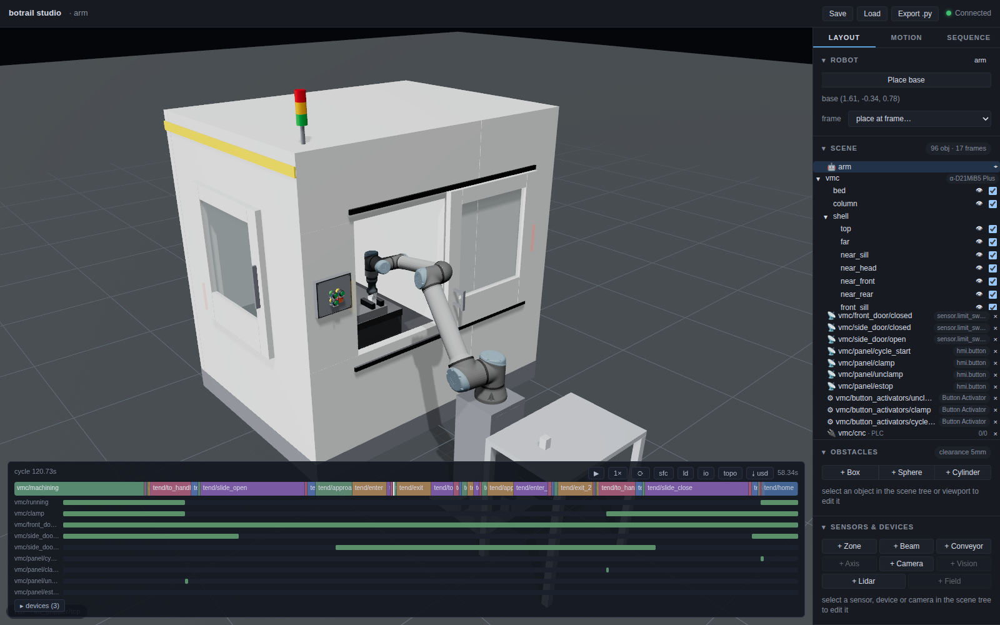
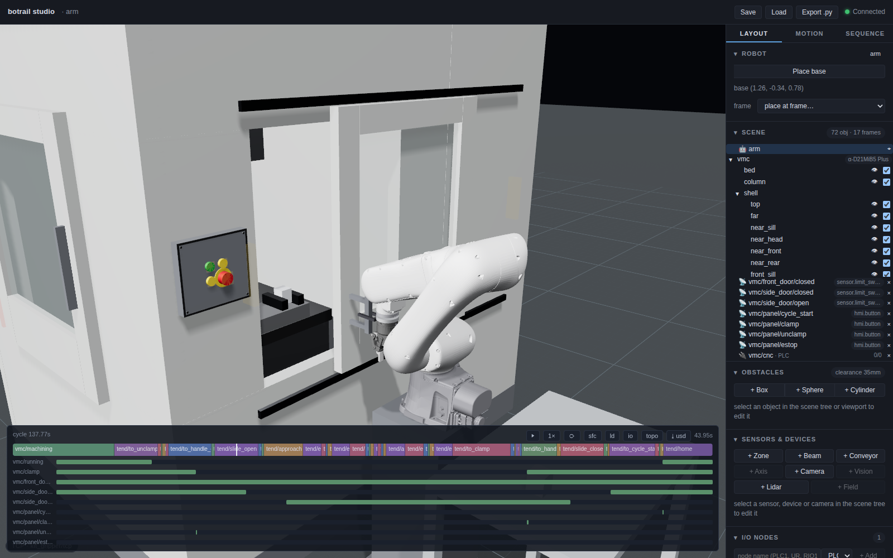
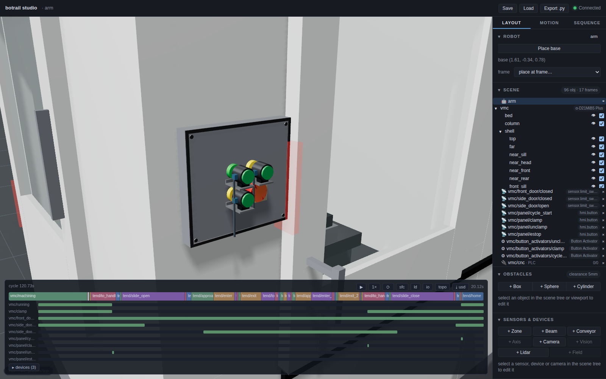
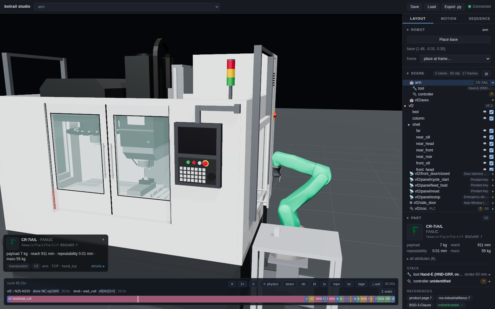
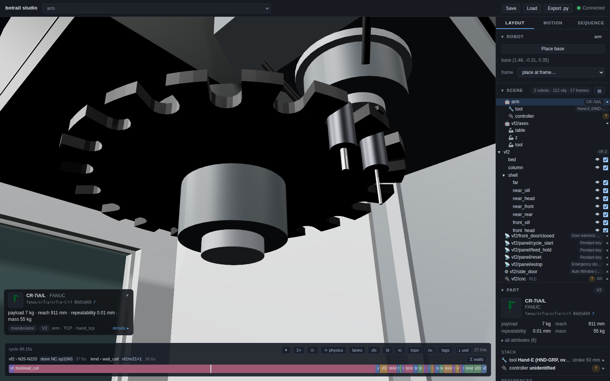

# Machine tending

A robot at the side door of a machining centre, swapping the finished
part in the vise for a blank between cycles — the cell every machine-tool
builder photographs. botrail builds it from products and public figures:
the machine is the *envelopes* a tending cell verifies against, its
behaviour is one more PLC program scanned beside the robot's, and a
button is a zone sensor as deep as its stroke.

```python
import botrail as bt

vmc = bt.parts.machine_tool(scene, "vmc", door="servo", door_side="right",
                            panel="door", buttons=("cycle_start", "clamp", "unclamp", "estop"))
(tx, ty, tz), _ = scene.frame("vmc/table")
vise = bt.parts.vise(scene, "vise", (tx + 0.25, ty, tz), opening=0.054)

hs = bt.tending.fanuc_ri2(scene, vmc, cycle_s=42.0, clamp_s=0.8, notice_s=5.0)
tend = scene.sequence("tend")                       # the robot's program, by hand
tend.step("wait", transition=bt.seq.signal(hs.signal("notice")))
...
tl = scene.simulate_sequences(["tend", hs.program])
```



The worked example is
[`examples/machining/machine_tending_demo.py`](https://github.com/neka-nat/botrail/blob/main/examples/machining/machine_tending_demo.py):
a UR12e on a catalog robot stand at a ROBODRILL-sized machine
with no robot interface — the retrofit — worked through its door and its
panel using a Robotiq Hand-E for the part and door handle, and three
panel-mounted Robotiq Button Activators for the buttons.

## The machine as envelopes

[`bt.parts.machine_tool`][botrail.parts.machine_tool] stands a vertical
machining centre as boxes, all of them collision-checked, none of them a
shape: the enclosure with its front and side openings, the **table at its
exchange position** (a table that traverses to the door is what a robot
reaches), the **spindle head** retracted over it, the **side door leaf**
sliding along the wall, and an **operator panel**. Without arguments it
is the FANUC ROBODRILL α-D21MiB5 Plus of the public catalogue — the side
auto-door opening 705 × 869 on an 827 mm sill, the 650 × 400 table, the
250–580 mm nose-to-table — and every figure is a parameter. The one
number the catalogue does not print, the table's height above the floor,
defaults to 0.90 m and is the first to replace when the drawing is at
hand.

Why boxes: what a tending cell verifies is whether the arm and the part
pass the opening, whether the wrist clears the head, whether the door
shuts on anything — and those are answered by the opening, the head and
the leaf, not by the sheet-metal profile a few centimetres away. A
vendor's CAD, where its licence allows, layers over these as a mesh
(`scene.load_usd`) and changes nothing the cell verifies.

Not every enclosure is a closed box. `enclosure_height` is a machine
whose sheet metal stops below its own height and is open on top — a Haas
VF-2's walls end at 1818 mm while its spindle head rises to 2724 mm: the
walls stop there, no roof is built, and the column and the head stand to
the body's height.

Frames come with it: `<name>/table`, `<name>/entry` (where an arm waits,
150 mm outside the leaf), `<name>/door/side/handle`, and one per button.
A plan that does not fit is refused with the numbers — an opening off its
wall, a stroke off the body, a head through the roof — the way a wall
plan that does not close is.

### The door

`door="servo"` or `"air"` makes the leaf a **linear axis**
`<name>/side_door` with two named stops: `bt.seq.move_to(door, "open")`
opens it at the speed its drive is published to run (a servo door covers
800 mm in 0.8 s where an air cylinder takes 2 s), `move_to(door,
"closed")` shuts it, and the stops' lanes `<name>/side_door/closed` and
`/open` are the limit switches an interlock is written from — on the
chart as lanes, on the I/O list as inputs. `door="manual"` leaves the
leaf loose for a robot that takes the handle — attach the `door_objects`
and run a `cartesian_line` along the wall — and two zone sensors under
the same names read the loose leaf at its ends.

The leaf slides toward the rear along the wall, or — `door_slide="up"` —
**lifts**: a window whose leaf rests on the sill and rises by
`door_travel`. Where that is less than the opening is tall, the raised
leaf's lower edge is what the arm passes under, so the way in is the
stroke, not the hole in the sheet metal; `<name>/entry` is the centre of
what is left clear. A lifting leaf rises clear of the body, so no stroke
runs it off. And an opening need not stand on the chamber's centre:
`door_offset` moves it along the wall, toward the rear.

The door enforces itself. What an axis drives is checked against every
robot each tick, the way two arms are checked against each other: a leaf
the machine closes on an arm still inside stops the bake at that tick
with a `DeviceCollision` naming the door, the leaf, the robot and the
link. The classic mistake — the exchange reported done before the arm is
out — is exactly that error, at the second the leaf meets the forearm.

### Buttons

[`bt.parts.operator_panel`][botrail.parts.operator_panel] puts a grid of
22 mm pushbuttons on a plate. Each is a cap (drawn, never collided), a
**zone sensor the size of the cap and as deep as the operating travel**,
sitting just inside the cap face, and two frames — `<panel>/<button>` on
the face and `<panel>/<button>/press` 2.6 mm in, both with +Z into the
panel. A tool that touches the cap reads nothing; one that pushes it the
travel a 22 mm actuator has turns the input on for as long as it is held.
Nothing moves: the stroke is a depth, and the input is the meaning. The
E-stop is the ø40 mushroom with its 44 N on the bill, and the neighbour's
zone is the check that a wide tool did not press two.

### The vise

[`bt.parts.vise`][botrail.parts.vise] stands a vise on the table with
its jaws `opening` apart and the frame `<name>/jaw` on the jaw floor
between them. Clamping is a signal the machine's program writes, not a
jaw that moves; an opening past the vise's maximum is refused.

## Ordering the machine

The envelopes are what a catalog pack carries. A machine tool's pack
(`kind: spec`, category `machine_tool.vmc`) has no geometry — it has
`mechanical.envelope` (the openings with their sills and strokes, the
table, the spindle nose to table), the options the maker sells
(`column_mm`, `side_door`, `door_side`), the published door times, and
an `interface`: the handshake template and the maker's signal table. Pass
its id and the generator reads all of it:

```python
vmc = bt.parts.machine_tool(scene, "vmc", catalog="fanuc/robodrill/alpha-d21mib5-plus",
                            side_door="servo", door_side="right", panel="door", buttons=BUTTONS)
vise = bt.parts.vise(scene, "vise", (tx + 0.25, ty, tz), catalog="botrail/fixture/vise-125",
                     jaw_width=0.125, opening=0.054)
hs = bt.tending.fanuc_ri2(scene, vmc)        # checks the pack's template
```

How a door opens is the machine's, not an option, so it is in the
envelope too: a side door of `kind: lift` with its `offset_mm` along the
wall, and the `enclosure_height_mm` of an enclosure open on top. The Haas
VF-2's pack (`haas/vf/vf-2`) reads that way — figures from the layout
drawing, and the heights the drawing leaves out (the table's 853 mm, the
enclosure's 1818 mm) measured from the maker's 3D model:

```python
vf2 = bt.parts.machine_tool(scene, "vf2", catalog="haas/vf/vf-2", exchange=(0.381, 0.050))
hs = bt.tending.haas_autodoor(scene, vf2)    # M180 / M181 on the cell-safe input
```

A drive the pack does not sell is refused with the ones it does, and a
door a robot slides (`door="manual"`) takes the pack's leaf and stroke
without ordering a drive; the machine, its side door and its panel land
on the bill with the pack's article numbers — and, where the pack names
it (`door_switch`), so does the door's own interlock switch; a pushbutton box (`botrail/hmi/button-box-22`) orders
the same way by its number of positions. And the opening decides the
arm before anything is taught: `scene.requirements()` asks the robot
beside the machine for the reach to its table, so
`bt.catalog.search_for` lists the arms that can serve it. The demo's
`--catalog` builds the cell this way.

### A lathe

[`bt.parts.lathe`][botrail.parts.lathe] is the turning counterpart: the
Haas ST-10 of the public spec pages as boxes — a 3.20 m body, the front
door opening centred on the spindle, the headstock and the spindle nose
`<name>/spindle` (+Z along the axis toward the tailstock), the turret's
envelope beside it — and the same door vocabulary on the *front* door,
which is the one a robot loads through: a linear axis with `closed` /
`open` stops, or a loose leaf with two limit switches. The chuck is a
part of its own, mounted on the spindle frame:

```python
lathe = bt.parts.lathe(scene, "lathe", door="manual")
chuck = bt.parts.chuck(scene, "chuck", *scene.frame("lathe/spindle"), opening=0.050)
hs = bt.tending.manual(scene, lathe, buttons=("unclamp", "clamp", "cycle_start"))
```

`<chuck>/face` is what a load aims at — a part comes in along its -Z,
the jaws stand proud of the face around the gripping diameter, and
`bt.tending` takes the lathe as it takes a machining centre (its one door
is the front door, so no door-exclusivity guard applies). What no public
page prints — the opening, the spindle's height and depth — are design
values, the first to replace from a drawing.

## The machine's program

A machine tool is not a device the robot commands. It runs a part program
and talks in a fixed vocabulary — for FANUC's Robot Interface 2: `M62`
announces the end of the cycle early, `M60` unclamps and opens the side
door, SERVICE REQUEST holds while the door is at its open end, the robot
asks for the work clamp and reports the exchange done, the door shuts
before the next cycle. [`bt.tending.fanuc_ri2`][botrail.tending.fanuc_ri2]
authors that as a sequence of its own, and the cell runs two programs:

```python
hs = bt.tending.fanuc_ri2(scene, vmc, cycle_s=42.0, clamp_s=0.8, notice_s=5.0)
hs.signal("service_req")    # the name the robot's program waits on
hs.signal("clamp_req")      # the one it writes
tl = scene.simulate_sequences(["tend", hs.program])
```

Request and acknowledge run on levels, the PLC way: the robot raises
`clamp_req`, the machine answers `clamp`, the robot drops the request
once it sees the answer; `service_ok` goes up **after the arm is out**
and comes down when it is home. The template also declares the CNC as an
I/O node hosting the machine's program, so the derived I/O list shows the
handshake as wires between two controllers and the PLCopen export carries
the machine's POU on a resource of its own.

[`bt.tending.manual`][botrail.tending.manual] is the retrofit: no
interface, the robot presses UNCLAMP, CLAMP and CYCLE START on the panel
and slides the door itself. The machine program waits on the buttons'
rising edges — and on the door's closed lane for the start, so a start
pressed with the door open is ignored, the way a guard interlock ignores
it, and the bake reports the deadlock naming the step.
[`bt.tending.haas_autodoor`][botrail.tending.haas_autodoor] is the Haas
vocabulary — `M80`/`M81` work the door only while the cell-safe input is
on, cycle start closes it — and
[`bt.tending.generic`][botrail.tending.generic] the vendor-neutral
request/acknowledge most relay interfaces reduce to, with
`signals={role: name}` to carry the maker's own tags onto the I/O list.

In those four the machine's program is written by the template and
machining is one step of it. [`bt.tending.haas_mfin`][botrail.tending.haas_mfin]
turns that round, the way a Haas is actually integrated: the **part
program** runs the cell and the machine's program is read off its text —
see [A part program that runs the cell](#a-part-program-that-runs-the-cell).

Whatever the vocabulary, every template writes the same three guards
into the machine's program, the way ISO 16090-1 has a machining centre
written: the side door opens only with the **front door closed** (the
machine has a closed switch on it, `vmc.front_door_lane`); a cycle starts
only with the side door **confirmed at its closed end** — the switch, not
the command; and nothing starts with the **E-stop** pressed
(`vmc.estop`, the panel's mushroom). They are what the
[interlock table](#handing-over) reads back as rows.

## The commercial hand and panel actuators

The demo follows the [Robotiq Machine Tending Solution](https://robotiq.com/solutions/machine-tending):
a single Hand-E handles the workpiece and opens/closes the door by gripping
its handle. Button Activators stay fixed over UNCLAMP, CLAMP and CYCLE START.
The robot carries no lateral pusher or fork and needs no tool exchange.

```python
arm = bt.Robot.from_catalog("universal_robots/ur/ur12e/r1")
kit = bt.Robot.from_catalog("robotiq/hand-e/hand-e-ur-es-077-kit/r1")
robot = arm.attach_tool(kit, prefix="kit_")
```

The kit includes the ES-077 coupling selected for a female-wrist UR12e.
Robotiq confirms that [UR12e retains UR10e solution compatibility](https://blog.robotiq.com/knowledge/understanding-the-difference-between-ur10e-and-ur12e).
The longer arm keeps both the vise and the door's full stroke reachable
with the compact Hand-E.
The catalog Hand-E uses standard overmolded fingers with 50 mm opening;
the demo's 40 × 40 × 60 mm workpiece leaves 5 mm clearance per side.
The TCP-to-pad offset is accounted for when teaching both the part and handle.



The three Button Activators are authored runtime reference geometry in
`examples/machining/_robotiq_tending.py`, using `bt.parts` and boxes. Each
moving foot drives only its own button's zone sensor. The simulated CNC still
waits for sensed presses; the arm program does not write the button inputs.
Bracket/body dimensions are visual estimates, while the stroke comes from
the cell's button geometry. Their pneumatic speed is a simulation setting.



This is a component-based simulation reference, not a qualified standard
Robotiq package. Three independent pneumatic channels, controller/URCap
configuration, status-light detection, actual door effort, full mounted
load/CoG and physical installation remain to be verified. The default kit
includes one Button Activator; the other two are additional components.

## What the bake says

Every lane of the handshake is on the chart in the order it happened —
door, request, clamp, buttons — and readable with
[timeline assertions](timeline-assertions.md):

```python
assert tl.signal("vmc/side_door/open").rising_edges()[0] <= tl.step_span("tend/enter").start
assert tl.signal("vmc/side_door/closed").rising_edges()[-1] > tl.step_span("tend/exit_2").end
assert tl.signal("vmc/panel/estop").high_spans() == []
```

The bill lists the machine, its door with the drive and the stroke, the
panel and each button with its head size, travel and force, the vise and
the stand; the I/O list, the topology and the PLCopen file come from the
same source. See [the I/O map](io-map.md) and
[offline commissioning](offline-commissioning.md).

## Two machines, one arm

[`examples/machining/two_machine_cell_demo.py`](https://github.com/neka-nat/botrail/blob/main/examples/machining/two_machine_cell_demo.py)
stands two ROBODRILL-sized machines facing each other across an aisle,
the arm on its stand between their side doors and a bench per machine
beside it, and teaches the far machine with the same
`machine_tending_demo.teach` / `program` as the near one — prefixed
`a_` / `b_`, the shared park motion once. Each machine runs its own
`bt.tending.manual` program; the arm's program serves A, then B. With a
part program longer than the swap, the arm is the constraint, and the
bake says by how much: `tl.utilization("arm")` for the arm, the
`running` lane's high time for each spindle. The interlock table then
carries three programs, the PLCopen file three resources (`arm`,
`vmc_a_cnc`, `vmc_b_cnc`), and the handshake spec both CNCs.

Two things the far machine taught: a machine straight behind the base
sits at J1 = ±π, and the IK converges from one winding and not the
other, so the teach seeds both; and a straight-line move (take the
handle, slide, let go) must stay on one IK branch end to end, so the
four handle poses are solved as a chain from the tightest one, never
each from its own seed.

## A window that lifts

[`examples/machining/vf2_tending_demo.py`](https://github.com/neka-nat/botrail/blob/main/examples/machining/vf2_tending_demo.py)
is the cell Haas sells as a robot package: a VF-2 from its catalog pack,
a FANUC CR-7iA/L with a Hand-E on a low pedestal at the right-hand
window, the machine run by its own part program. The window is the
question the cell answers. Its opening is 676 × 749 mm on an 819 mm sill,
but the leaf lifts only 595 mm, so the arm goes in under the leaf's lower
edge at 1414 mm — and how tall the pedestal may be follows from that: at
350 mm the elbow clears the leaf by 63 mm; at 450 mm the forearm meets it
and the run through the window is refused. The table is
parked where the part program leaves it for the exchange (the far end of
X, toward the window), and the answer that lets the program close the
window is given only once the arm is out: given a step early, the bake
stops with the leaf on the forearm.

## A machine that runs its program

In the cells above machining is a timer: the table stands at its exchange
position and `cycle_s` is a number someone typed. A machining centre
built with its **axes** runs a part program instead.

```python
vf2 = bt.parts.machine_tool(scene, "vf2", catalog="haas/vf/vf-2", exchange=(0.381, 0.050), axes=True)
```

`axes=True` takes the pack's travels, home and rates (`axes=bt.parts.MachineAxes(...)`
types them in), and the saddle, the table and the spindle head become the
links of a mechanism `vf2/axes`: three prismatic joints `x`, `y`, `z`
whose values are the **machine coordinates** — zero at home, running to
the negative side, the way these machines are built. X and Y move the
table, Z the head. It is checked against every arm each tick like any two
robots, but it is not an arm: no line of its own on the bill, no
controller, no reach on the layout sheet. `exchange` is where it is built
standing, and `vf2.park` says what machine coordinates that is.

The mechanism is declared as an **NC machine** — a control, as far as
running a program needs one: the travels and rapid rates (its joints'
limits), the greatest feed, the accelerations, the changer's time, and the
two tables an operator fills in at setup.

```python
bt.nc.set_work_offset(scene, vf2, "G54", at=part_top)      # derived from the cell
bt.nc.set_tool(scene, vf2, 1, length=0.110, diameter=0.010)
bt.nc.program(scene, "op10", Path("op10.nc"))
print(bt.nc.check(scene, vf2, "op10").summary())
# op10 on vf2/axes: 62.7 s — cutting 43.7 s over 324 mm, rapids 10.6 s over 3218 mm,
# standing 8.4 s, 2 tool changes; axes within X -762.0 to -19.0, ... mm (machine coordinates)
```

A work offset is the machine coordinates of the work zero. `at=` gives it
as a point in the cell — a corner of the part, a frame on the fixture —
and the figure is worked out from the mechanism, the way an operator finds
it with an edge finder: move the vise and its offset moves with it. `xyz=`
enters the figures off a real machine's offset page as they are. A tool is
its gauge length, what `G43 H<n>` adds to Z.

[`bt.nc.check`][botrail.nc.check] is the dry run: the program read the way
the control would read it, and timed. What it is made of is the dialect a
CAM post writes for 3-axis milling on a Haas — linear and circular moves,
work offsets, tool length, tool changes, machine-coordinate moves, dwell,
the drilling cycles. What the control cannot read is **refused with the
line number, never skipped**: a word it does not know (cutter radius
compensation, a macro, a subprogram), a work offset or a tool nobody
entered, a spindle speed the machine does not have, a point past an axis's
travel. Timing is a control's look-ahead in outline — a rapid runs
straight from rest to rest at the axes' rates, a run of cutting moves is
one path at the programmed feed, slowed for corners and bounded by the
axes' accelerations — an estimate of the cycle, not a servo model.

In a cell the program is one action, `bt.seq.run_program(vf2.axes,
"op10")`, and the tending templates take it in place of their timer:

```python
for piece in vise.obstacles:                               # bolted to the table
    scene.attach(piece, link=vf2.table_link, touch_links=[vf2.table_link], robot=vf2.axes)
hs = bt.tending.haas_autodoor(scene, vf2, part_program="op10", parts=("part", "blank"))
```

The machining step is then as long as the program takes. The template
reads the program once as it is authored, so a refusal comes there and by
line — and so does a program that does not end at the exchange position
the machine was built at, where the arm is taught. `parts` names what the
vise holds, because on a table that moves it matters: the part clamped
through the cycle rides the table and is freed at the unclamp; the one the
cell loads is taken as the door closes on the next cycle, once the arm has
let go of it.

With the tools entered as bodies the program also **cuts**: the block is
carved on the table and leaves in the gripper as the part, a dry run names
the line where a tool meets what it should not, and the first part is
measured against its design — see [NC machining](nc-machining.md).

## A part program that runs the cell

A Haas is not started from outside. The way it is integrated, one part
program **keeps running** and works the cell itself, with M codes: it
cuts the part, moves the table to the window, opens the vise (`M71`) and
the window (`M180`), calls the robot through a user relay (`M21`) and
waits for the answer — the **M-FIN** input — clamps (`M70`), closes the
window (`M181`), and starts over on `M99`.

```text
N220 G53 G0 X-762. Y-160.5    (the table to the window)
N300 M71                      (vise open)
N305 M180                     (window open)
N310 M21                      (robot: part out, blank in and held)
N315 M70                      (vise closed)
N320 M22                      (robot: let go and leave)
N325 M181                     (window closed)
N330 M99
```

Those codes are not the control's to carry out — it hands them to the
machine and waits. They are the machine's **M-code table**, and
[`bt.tending.haas_mfin`][botrail.tending.haas_mfin] is the Haas one, on
this machine's door, vise and relays:

```python
hs = bt.tending.haas_mfin(scene, vf2, "op10", parts=["part", "blank"],
                          relays={21: "arm: part out, blank in", 22: "arm: let go and leave"})
tl = scene.simulate_sequences(["tend", hs.program])
```

Nothing of the machine's side is written by hand. The template reads the
program and **derives the machine's program from it**
([`bt.nc.sequence`][botrail.nc.sequence]): the stretches the control runs
on its own — its *blocks*, `bt.seq.run_program(vf2.axes, "op10", block=k)`
— and, at every M code of the table, the step that answers it. The steps
are named after the program's lines, so the timing chart, a stall and the
documents all say where in the text they are:

```text
vf2/N25-N220                         0.00 -  68.40    the cut
vf2/N300 M71 vise unclamp           68.40 -  69.20
vf2/N305 M180 door open             69.20 -  70.69
vf2/N310 M21 arm: part out, …       70.69 -  83.25    the arm swaps the parts
vf2/N315 M70 vise clamp             83.26 -  84.06
vf2/N320 M22 arm: let go and leave  84.06 -  86.64
vf2/N325 M181 door closed           86.65 -  88.14
vf2/N25-N220                        88.14 -   …       and over again
```

What the table says of each code:

| code | what the machine does | goes on when |
|---|---|---|
| `M80` / `M81`, or the pack's (`M180` / `M181` on a VF's window) | sends the door to its end | the end's switch reads — **needs the cell safe**, and the front door shut to open |
| `M70` / `M71` | clamps / unclamps the vise | `clamp_s` later |
| `M21`…`M28` (`relays=`) | raises the relay | `m_fin` comes — then drops the relay and waits for `m_fin` to go |

Three things follow from reading the program this way.

**A guard is an alarm, not a wait.** A real control that finds the
cell-safe input low at its `M180` does not wait for it: it alarms and the
program stops (a Haas reports alarm 548). So does this one — the step
after is `… ALARM — the cell is not safe or the front door is open` and nothing leaves it — and a
cell that raises the input *late* stalls, by name and by line, where a
wait would have let it through. A block that turns the spindle is guarded
the same way by the doors' closed switches and the E-stop.

**The vise holds what stands in it.** `M70` and `M71` write a coil,
`<machine>/clamp`, and the table's grasp follows it
([`scene.bind_grasp`](attach-and-tracking.md#a-grasp-that-follows-a-coil)): on, the table takes
whichever of `parts` stands in the vise; off, lets it go. Nothing is
attached by name, cycle after cycle. The arm answers the first call with
the blank in the jaws and still in its hand; the program clamps; the arm
lets go on the second call — and the blank is the vise's from the next
tick. A program that cuts without its `M70` leaves the part behind as the
table moves off.

**The relays are called where the arm was taught.** A relay's row says
where the axes must stand when it is called — the exchange position the
machine was built at — so a program that calls the arm before it has
moved the table there is refused as the cell is built, with the line.
And an M code that is in nobody's table is refused like any other word
the control cannot read.

On the cell's side the arm's program holds `cell_safe` on, waits for the
relay, does the work, raises `m_fin`, and drops it once the relay has
dropped — levels both ways, so a second call cannot take the first
answer for its own.

**The front door, where it is the automatic one.** A machine built with
`front_drive="air"` (or `"servo"`) has an automatic front door: two
leaves that part from the middle, each on an axis of its own
(`<name>/front_door/left`, `/right`), checked against every robot each
tick like the side door. The program's `M80` and `M81` are then that
door — both leaves at once, the program going on when both stand at
their ends — and the side door keeps the codes its pack names (`M180` /
`M181` on a VF). The two doors are never open together: either's opening
needs the other shut, an alarm otherwise.

```python
vf2 = bt.parts.machine_tool(scene, "vf2", catalog="haas/vf/vf-2", exchange=(0.0, -0.10),
                            axes=True, front_drive="air")
hs = bt.tending.haas_mfin(scene, vf2, "op10", parts=["part", "blank"])   # M80/M81: the front door
scene.frame("vf2/front_entry")        # where an arm waits at it
```

In the studio the program is the **NC** panel
([the control](studio.md#the-control-nc)): the line running, the M code
the control stands at, the offsets and the tools.

The control's own states are lanes without being asked for:
`<axes>.spindle` and `.coolant`, and the words `.rpm`, `.tool` and
`.line` (the source line running; 0 while the control waits).

`vf2_tending_demo.py` is this cell: two tools, five facing passes, a
pocket and four pecked holes, then the exchange — 68 s of cutting in an
89 s cycle, `G54` derived from where the part stands in the vise. The
vise is not as far toward the window as it would go — the spindle only
reaches 381 mm from the table's centre, and a part nearer the table's end
than its own half width could not be faced (`--setup vise_out` bolts it
there, and the program is refused at the line that would take X past its
home). Its scenario `no_cell_safe` breaks the cell-safe wire, and its
`deliver()` writes the document set: the interlock table's rows are the
program's M codes with their guards —

```text
| N305 M180 door open | device `vf2/side_door → open` | `(vf2/cell_safe AND vf2/front_door/closed)` |
```

— the handshake sheet has the relays and the M-FIN with who writes and
who waits, and the FAT sheet has the broken wire stalling the program on
its alarm, beside a row per row of the interlock table.

## The machine drawn as a model

The envelopes are what the cell is verified against, and they look like
it. `shape=` draws the machine as a model of it — and verifies it exactly
as before:

```python
vf2 = bt.parts.machine_tool(scene, "vf2", catalog="haas/vf/vf-2", exchange=(0.381, 0.050),
                            axes=True, shape="haas/vf/vf-2-reference")
```



`shape` is a catalog **model package** of the machine (an id, or the
directory of a local build) whose links are named for what they are.
Every box above is still built, still collided, and no longer seen; the
package's links are their picture:

* `saddle`, `table` and `head` ride the mechanism's links of the same
  name, so the casting you see is what runs the part program — the table
  under the spindle, the head down into the cut;
* `side_door` (or `side_door_left` / `side_door_right`, the one on the
  door's side) rides the door. It stands shut where the door is shut,
  whatever pose the file drew it in — a maker's file may have a window
  modelled lifted, and the package's joint says which end of the stroke
  is shut. A window on the far side stands shut and stays there;
* `front_door_left` and `front_door_right` ride the leaves of a front
  door that is driven (`front_drive=`), and stand shut where it is not;
* `tool_shuttle` and `tool_carousel` are an umbrella **tool changer**
  (below);
* everything else — the base, the enclosure, the pendant — stands still.

The package's root frame is the machine's own (the middle of the footprint
on the floor, front on -Y) and the file stands at **machine home**: the
picture is placed from there, the table's moved to the exchange position
with the table. That is why `shape` needs the machine's `axes` — they are
what says where home is. The pictures are `<name>/shape/<link>`, out of
collision; the body's is carried by a box the size of the machine, so the
layout sheet still shows its footprint. A link the model draws in
several materials is several pictures (`…/shape/body`, `…/shape/body_1`,
…), and glass is seen through. The bill, the interlock table, the cycle
and every clearance are the same to the last digit with and without it:
a mesh is the picture, and a box is what gets checked.

**A tool changer in the picture is worked by the control.** Where the
package draws one — a link `tool_shuttle` on a sliding joint of that
name (drawn at rest; its upper limit is at the spindle), a link
`tool_carousel` on a joint of that name that turns freely, and
`specs.tool_capacity` in its manifest for the pockets — the machine's
mechanism gets those two joints (`vf2.changer`), and the control works
them at every tool change of a part program: with the head at the top of
its travel the shuttle runs in, the carousel turns the next tool's pocket
to the spindle the short way round, and the shuttle runs out, within the
machine's tool-to-tool time. Tool `n` lives in pocket `n`. It takes no
time of its own — the program is as long as on the machine drawn without
it — and it is drawn, not checked: nothing of the changer is collided,
and the head's lift off the tool is not part of the picture. With the
tools drawn ([`bt.nc.animate`](nc-machining.md#in-the-cell)), a tool that
is not in the spindle rides its pocket.



**Where the model comes from.** `haas/vf/vf-2-reference` is a *reference
model*: drawn from numbers — the maker's published layout drawing
(widths, heights, travels, the table and its T-slots, the door openings,
the tool changer's circle) and the figures of the machine's own pack —
with the castings and covers estimated, and no geometry of the maker's
own 3D model in it. It is in the catalog like any
other pack, and `vf2_tending_demo.py` draws the VF-2 with it (as the
envelopes where the catalog cannot be reached — the same cell either
way).

A maker's own CAD can be the picture too. It is usually yours to download
and not anyone's to pass on, so such a package is not in the published
catalog; its **recipe** is: the catalog builder's
`recipes/haas/vf-2-cad-r2.yaml` names the file, pins its sha256 and says
where a person downloads it; you place the ZIP where the build looks,
build the package on your own machine
(`BCB_LOCAL_SOURCES=~/Downloads bcb build recipes/haas/vf-2-cad-r2.yaml`)
and pass its directory as `shape=`. The two packages keep the same links
and joints; the reference model has the tool changer's shuttle and
carousel as links of their own besides.

To read a package's pictures yourself, a robot loaded from USD says what
each link is drawn from: `robot.visuals(positions)` lists the gprims with
where they stand, and `robot.link_poses(positions)` the link frames.

## Handing over

The demo's `deliver()` writes the cell's document set from the one
source — and three of its pages are what a machine-tending cell is
handed over with in particular:

* **The interlock table** ([`scene.interlocks()`](io-map.md#the-interlock-table)):
  every output of both programs against the condition that admits it.
  The machine's `cycle_start` row reads
  `(RISING(vmc/panel/cycle_start) AND vmc/side_door/closed AND vmc/front_door/closed AND NOT vmc/panel/estop)`
  — the three guards, as the control designer would write them down —
  and names the buttons as sensors on the CNC; the robot's `to_unclamp`
  row waits on `NOT vmc/running` and names the machine's steps that
  write it, which is the handshake read across the table.
* **The PLCopen file** with the machine's program as a POU on the CNC's
  own resource (`vmc_cnc`) beside the arm controller's (`arm`), so each
  side's IDE takes its own — the machine builder's PMC logic is a
  deliverable, not a description.
* **The layout sheet** with the door: a driven door draws its leaf at
  the open end of its travel (dashed) with the travel arrow; a loose leaf
  its two limit switches at the ends of the stroke — the envelope a plan
  keeps clear of the stand and the stocker.

And the **FAT sheet**: the faults a control designer would test for are
written as test cases — the fault, and what must follow — and run as a
sheet, each case a run of the same cell
([the FAT](virtual-commissioning.md#tests-as-a-table-the-fat)):

```python
cases = [
    bt.vc.TestCase("nominal cycle", expect=[bt.vc.cycle_within(tl.duration + 1.0)]),
    bt.vc.TestCase("door switch stuck", faults=[bt.io.stuck(hs.signal("door_closed"), False)],
                   expect=[bt.vc.stalls(hs.program, at="wait_start")]),
    bt.vc.TestCase("clamp button open", faults=[bt.io.open("vmc/panel/clamp")],
                   expect=[bt.vc.stalls(hs.program, at="wait_clamp")]),
    bt.vc.TestCase("E-stop pressed", faults=[bt.io.stuck(hs.signal("estop"), True)],
                   expect=[bt.vc.stalls(hs.program, at="wait_start")]),
    *bt.vc.interlock_tests(scene, hs.program),      # a row per row of the interlock table
]
fat = bt.vc.run_fat(scene, cases, ["tend", hs.program])
fat.save("machine_tending_fat.md")
report = scene.cell_report({"baseline": tl}, scenarios=runs, deliverables=files, sections=[fat.section()])
```

— and the sheet shows the nominal cycle through and each fault
**refused** where it should be: the closed switch that never makes and
the E-stop in stall the machine at `wait_start`, the open wire on CLAMP
at `wait_clamp`. The same faults authored as scenarios
(`scene.add_scenario(..., faults=[...])`) fill the report's scenario
matrix, which says only that the cycle stalled; the sheet says at which
guard, and carries the interlock table's own rows beside the authored
ones. The report's *Machines* section lists the machine with its door
(drive, stroke, the lanes), its buttons and the controller hosting its
program.
