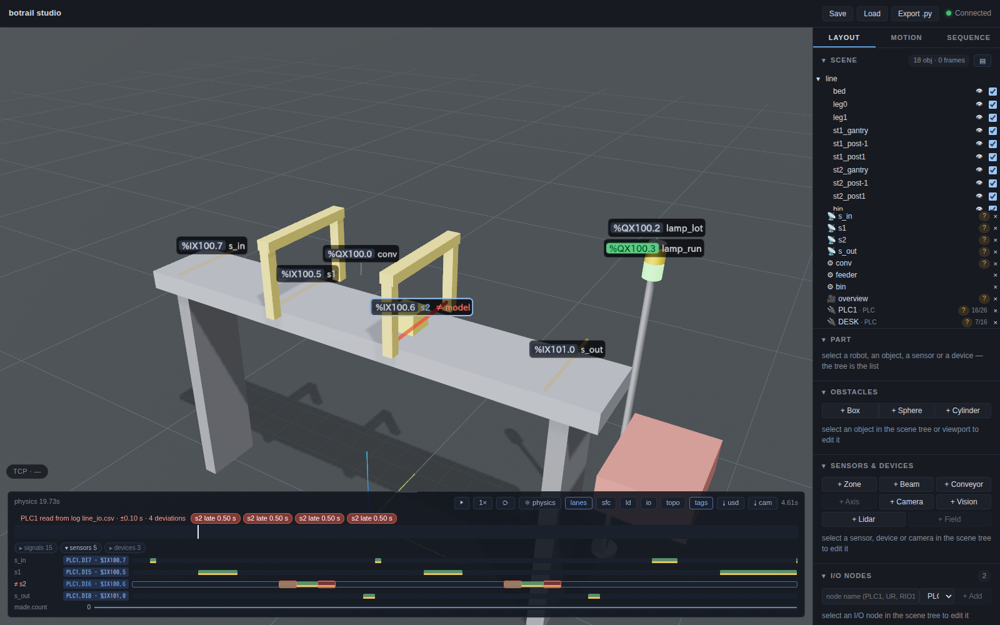

# Monitoring: a machine's log, and a running PLC read-only

[Virtual commissioning](virtual-commissioning.md) puts the cell where a
controller's I/O would be: botrail *writes* the controller's inputs. That is
for a controller under test, and only for one. A controller that runs a
real machine is never written — but it can be **read**, and this page is
what botrail does with what it reads:

* what the controller **wrote** (coils, device commands, robot starts)
  moves the model, so the 3D cell does what the machine was told to do;
* what the controller **read** and the model computes itself (sensors,
  limit switches, feedback words) is **compared** with the model's lanes
  and never written over them. A disagreement that outlasts the tolerance
  is a *deviation*: the machine's sensor came late, never came, or reads a
  level the model does not;
* what the controller read and the model has no source for (a push button,
  a selector, a setpoint keyed in at a panel) is **followed**: the model's
  lane takes the read value.

The same thing happens whether the image comes from a file the machine
logged yesterday or from the controller's server right now.

## A machine's log: `bt.vc.IoLog`

A PLC's logging function, a SCADA trend or a gateway exports the I/O image
as a table — a time column and one column per device. `IoLog` reads it
against the controller's [exchange](virtual-commissioning.md#the-exchange),
so each column lands on a point of the cell:

```python
xc = bt.vc.exchange(scene, "PLC1", programs)
log = bt.vc.IoLog.load("line_io.csv", xc)
log.unmatched        # columns that are no point of the cell (listed, not an error)
log.missing          # points of the cell the log does not carry
log.written, log.read
```

```csv
t,%IX100.5,%IX100.6,%QX100.0,%QX100.1
0.000,0,0,0,0
0.510,0,0,0,1
0.520,0,0,1,0
1.950,1,0,0,0
```

A column answers to the point's **address** (`%IX100.5`, `IX100.5`, or the
vendor notation the channels were declared with — `X0`, `Y20`, `D100`), its
PLC **tag**, its variable or its name; `names={"X0": "s1"}` maps anything
else. Both layouts are read: the wide table above (an empty cell is
"unchanged") and a long one (`t, name, value`). The time column is seconds
or a clock time (`2026-11-10 08:15:02.250`); the first row is zero unless
`t0=` says otherwise. Values are what the controller holds — `1/0`,
`on/off`, `true/false` on a bit, the register's number on a word.

A commissioning run writes the same table: `bt.vc.tap(link, xc)` is the
link with a logger on it.

```python
tapped = bt.vc.tap(bt.vc.modbus_server(xc), xc)
with bt.vc.Session(scene, programs, links={"PLC1": tapped}, pace="realtime") as s:
    s.run(for_=60.0)
tapped.log.save("line_io.csv")            # columns headed by address
```

## Replaying it: `bt.vc.monitor`

```python
with bt.vc.monitor(scene, programs, log) as m:
    m.run()                               # to the end of the log, as fast as it computes
    for d in m.deviations():
        print(d.note)
    tl = m.timeline()                     # the model's run, with the readings on it
    print(m.report())                     # what drove, what was compared, what parted
```

```text
`s2` rose 0.50 s later on the machine than in the model (4.36 → 4.86 s)
`s2` fell 0.50 s later on the machine than in the model (5.52 → 6.02 s)
```

`programs` are the cell's programs as for a plant session: the monitored
controller's own (the controller runs them; the model does not scan them)
and whatever the model scans itself (the
[equipment's programs](sequences.md#words-and-analog-inputs)). Leave out a
script that stands in for the operator — the controller reports the buttons.

The replay is deterministic: the same log gives the same timeline, and the
timeline is the ordinary one — the studio plays it, `export_usd` writes it,
`tl.waiting(t)` says what each program waited on. A deviation is `late` or
`early` (the machine's edge against the model's), `level` (the two stand
apart, or one side pulsed alone) or `value` (a word outside its band), and
`open` while the two still disagree.

| | default | |
|---|---|---|
| `tolerance=` | 0.1 s, or twice the source's sampling period | how long a reading and the model may disagree |
| `bands={lane: gap}` | 2 % of the value, 2 counts on an integer | how far a word may sit from the model's |
| `follow=[...]` | the read points nothing in the model drives, and the panel's push buttons | points the model takes from the controller instead of comparing |



In the studio the readings ride on the lanes: a thin trace under each
compared lane is what the controller read, a red band is where it parted
from the model, and a line over the lanes names every deviation — a click
seeks there and puts the point in focus. A point's [tag](studio.md#the-io-tags-tags)
and its row in the I/O table show what the controller read, marked `≠`
while the model says otherwise.

## A running controller, read only

```python
reader = bt.vc.modbus_reader(xc, "10.0.0.5:502", period=0.2)
with bt.vc.monitor(scene, programs, reader) as m:      # wall-clock time
    m.run(for_=600.0)
    m.log().save("shift.csv")                          # what was read: it replays later, exactly
```

A **reader** is a different type from the links of virtual commissioning,
and read-only by construction rather than by a flag:

* **`bt.vc.modbus_reader`** — a Modbus TCP client that sends read requests
  only: function codes 1 (coils), 2 (discrete inputs), 3 (holding
  registers), 4 (input registers). Its module has one request builder,
  which refuses any other code; nothing in it assembles a write. The
  numbering follows the IEC addresses (`%IX100.5` → discrete input
  `(100 − iec_base) × 8 + 5`; `iec_base=0` reads the image where OpenPLC
  serves it), `addresses={point: number}` places a point in another
  notation. `reader.function_codes` is every code it has sent.
* **`bt.vc.opcua_reader`** — an OPC UA client that reads each node once and
  then subscribes to its data changes. It never calls Write or a method.

Neither can start or stop the controller, load a program or set its clock.
The monitor itself has no `force`, `press`, `write`, `inject` or `apply`,
and refuses those commands from a studio: the dock shows
**MONITOR · read only**, the force column and the transport's hold / scan /
speed are not drawn, and a refused command is named on the bar. A link that
writes is not accepted as a monitor's source.

Three things to know before pointing a reader at a machine:

* **Reading is not free.** Every request is served by the controller's
  communication task. The period is explicit and unhurried by default
  (0.2 s for Modbus, 0.5 s for OPC UA) — slow it down on a busy CPU, and
  prefer the controller's OPC UA server, a gateway or its data logger to a
  direct connection to the CPU. Connecting a tool to a control network is
  the plant's decision (segmentation, permits), not botrail's.
* **A poll sees levels, not pulses.** A coil that is up for one PLC scan
  falls between two polls: the model never gets the command, and the
  comparison then shows the machine going on without it. Hold such a coil
  for longer than the period, poll faster, or replay the PLC's own log.
  An edge read by polling is up to a period late — which is why the
  tolerance defaults to twice the period.
* **The model starts where the scene does.** It does not know what the
  machine did before the monitor began to read, and a controller that
  stopped keeps serving its last image. Start with the machine in the
  state the scene is built in.

The model is an approximation: the 3D shows what the controller sees and
how the model moves under its commands — not a photograph of the machine.

## The demo

`examples/commissioning/monitor_line/run_demo.py` does both on the
[ladder line](sequences.md): it writes the line's I/O as a logger's CSV,
replays it (the model moves as the machine did, no deviation), delays one
sensor's column by half a second and shows the four edges that parted;
`--studio` opens the late replay, and `--replay file.csv` replays any log
of the line (the one the OpenPLC run writes). With OpenPLC running the line
(`--equipment`, standing in for the machine), `--monitor` mirrors it from a
second process through `bt.vc.modbus_reader`, and `--judge` runs both and
checks that the model made the same works, that only read requests went
out, and — with `--fault s2` — that the broken sensor is named.
