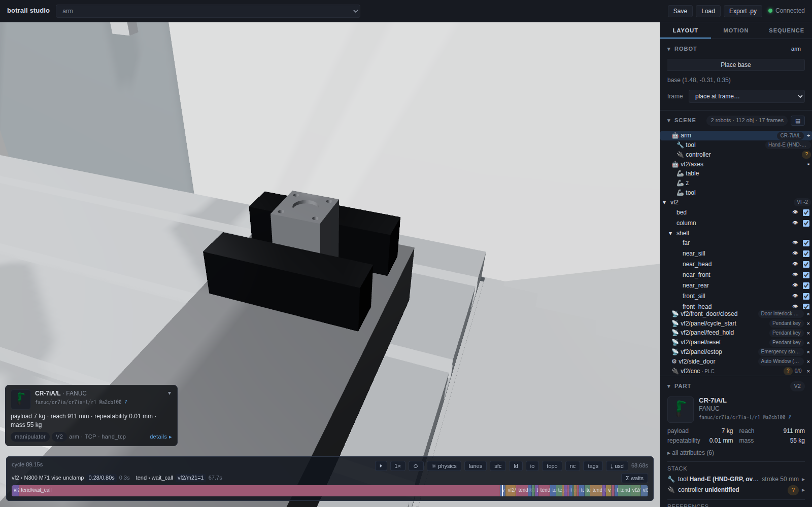

# NC machining: the setup, the dry run, the part

A part program is one of four things that meet at the cutter. The others
are entered at the machine: **where the work zero is** (`G54`), **what the
tool table says** each tool is, and **where the part really stands**. On a
real machine they are proven with a dry run and a first part. Here they are
the cell's own data, so the dry run and the first part are computed — and
a setup stood wrong shows up as a line number and a volume before anything
is cut.

This builds on [a machine that runs its program](machine-tending.md#a-machine-that-runs-its-program):
the axes are a mechanism, the program is read the way the control reads
it. What is added here is the material.



## Tools are bodies

A tool is entered as what stands in the spindle — the cutter, and the
holder it sticks out of:

```python
holder = bt.nc.Holder(diameter=0.040, length=0.075)      # gauge line to nose
bt.nc.set_tool(scene, vf2, 1, bt.nc.end_mill(0.010, flutes=0.022, stickout=0.035, holder=holder))
bt.nc.set_tool(scene, vf2, 2, bt.nc.drill(0.005, flutes=0.045, stickout=0.060, holder=holder))
```

`end_mill`, `ball_mill`, `bull_nose` and `drill` build one; its length —
gauge line to tip, the figure a presetter reads — is the holder's plus the
stick-out. **The tool table's entry is taken from the body**: 110 mm and
135 mm here, what `G43 H1` and `H2` add to Z.

The two can be made to disagree, because on a machine they can:

```python
bt.nc.set_tool(scene, vf2, 2, drill, length=0.115)       # entered 20 mm short
```

The axes are positioned by the table's entry; the tip is where the body
puts it. That difference is what a dry run is for.

A tool entered only as a length (`set_tool(…, length=0.110)`) still times
the program, and cuts nothing.

## The dry run

[`bt.nc.check`][botrail.nc.check] with a `stock` runs the program on the
machine alone — nothing else in the cell moves, nothing in the scene
changes — and cuts:

```python
run = bt.nc.check(scene, vf2, "op10", stock="part", fixtures=vise.obstacles, design="wp40.stl")
print(run.machining.summary())
# part on vf2/axes: 2.33 cm³ removed of 96.00 (T1 1.74, T2 0.59)
# the part is the design within ±0.05 mm
```

The stock and the `fixtures` ride the table from where they stand; each
tool's body is swept from the spindle nose through the stock; and
`run.machining` ([`Machining`][botrail.nc.Machining]) is what came of it:

* `removed_volume`, `by_tool()`, and `lines` — the material **each source
  line** removed;
* `issues` — what a tool met that it should not have, each with its line:

    | `kind` | what happened |
    |---|---|
    | `rapid_into_stock` | the cutter met the stock at rapid |
    | `spindle_stopped` | the cutter met the stock with the spindle stopped |
    | `holder_into_stock` | the shank or the holder met the stock |
    | `into_fixture` | the tool — any of it — met a fixture |

* against a `design` model, `excess_volume` (material left outside the
  design) and `gouge_volume` (material missing inside it), with the box
  each lies in;
* `part` — the machined part as a mesh (`part.save_obj(path)`);
* `ok` — nothing met anything, every tool called has a body, and the
  part is the design.

The design model is the finished part as a closed mesh file (STL or OBJ)
in the stock's own frame — for a box, its centre. `tolerance` (default
0.05 mm) is how far the part may stand from it before the difference
counts: deviations inside it are ignored, so it is also what absorbs the
facets of a round pocket.

## A setup stood wrong

Two mistakes an operator makes, on the cell of
`examples/machining/vf2_tending_demo.py`.

**The work zero entered 2 mm above the block.** Nothing crashes. The face
is cut in the air, the pocket and the holes come up 2 mm short:

```text
part on vf2/axes: 0.94 cm³ removed of 96.00 (T1 0.47, T2 0.47)
against the design (±0.05 mm): 1297.1 mm³ left over, 0.0 mm³ missing
```

No line of the program is wrong and no move is refused — only the
comparison says the first part is scrap.

**The drill entered 20 mm shorter than it is.** "15 mm over the part" is
5 mm into it, at rapid, on the line that calls the length:

```text
op10 line 46: the cutter meets `part` at rapid (T2, 88.1 mm³, at 40.75 s)
op10 line 48: the cutter meets `part` at rapid (T2, 254.6 mm³, at 40.82 s)
…
against the design (±0.05 mm): 0.0 mm³ left over, 3152.6 mm³ missing
```

`python examples/machining/vf2_tending_demo.py --setup g54_high` and
`--setup t2_short` run them.

A third never gets as far as a dry run. **The vise bolted 30 mm nearer
the window** (`--setup vise_out`) derives a `G54` from which the far side
of the part is past the X home, and the program is refused as the cell is
built:

```text
line 18: X 6.000 mm is past the X travel (-762.000 to 0.000 mm, machine coordinates)
```

## In the cell

The dry run assumes the stock stands where it stands. A baked cycle knows
where the arm really put it and what the table really did:

```python
tl = scene.simulate_sequences(["tend", hs.program])
cut = bt.nc.cut(tl, vf2, "part", fixtures=vise.obstacles, design="wp40.stl")
```

[`bt.nc.cut`][botrail.nc.cut] reads the bake — every program the machine
ran (or every block of one that
[runs the cell](machine-tending.md#a-part-program-that-runs-the-cell)),
from where its axes stood, against the stock's own track — and returns
the same `Machining`. The dry run of such a program reads it whole: its
M codes are listed (`run.functions()`) and take no time, since nothing
answers them there. So the fourth input is in the result too: a
part set down off its place is cut off its place.

[`bt.nc.animate`][botrail.nc.animate] is `cut` with the picture:

```python
shown, cut = bt.nc.animate(scene, tl, vf2, "part", design="wp40.stl")
scene.show_timeline(shown)        # or shown.export_usd("cell.usdc")
```

The stock is shown as it is cut, on the table that carries it under the
spindle, and it leaves in the gripper as the part. Each tool stands in the
spindle while it is the one in it — and, where the machine is drawn with
its [tool changer](machine-tending.md#the-machine-drawn-as-a-model), in
its pocket on the carousel the rest of the time, going from the one to
the other as the changer's shuttle comes in at a tool change. All of that
is display, out of
collision (`<stock>_cut/…`, `<machine>/tool/T<n>/…`): the stock itself
goes on being what the arm grips and the cell is checked against, unseen —
an arm is taught on the faces the block has, and nothing is re-planned
against the shape it is cut to. The display follows the cutter in steps
(`stage_period`, 2 s by default).

## The setup sheet

[`bt.nc.setup_sheet`][botrail.nc.setup_sheet] writes the setup down, as
Markdown, from the cell — so the sheet cannot disagree with it:

```python
Path("op10_setup.md").write_text(
    bt.nc.setup_sheet(scene, vf2, "op10", stock="part", fixtures=vise.obstacles, design="wp40.stl"))
```

```markdown
## Stock
- `part` (WP-40): 40.0 x 40.0 x 60.0 mm
- Centre from the middle of the table's top: X+330.000 Y+0.000 Z+95.000 mm (top face 125.0 mm above the table)

## Work offsets
| offset | machine coordinates [mm] | work zero from the stock's centre [mm] |
|---|---|---|
| G54 | X-51.000 Y-211.500 Z-485.000 | X+0.000 Y+0.000 Z+30.000 |

## Tools
| T | tool | flutes [mm] | holder ⌀ x length [mm] | length [mm] | table entry H [mm] | |
|---|---|---|---|---|---|---|
| T1 | 10 mm flat end mill | 22 | 40 x 75 | 110.000 | 110.000 |  |
| T2 | 5 mm drill | 45 | 40 x 75 | 135.000 | 115.000 | **entry -20.000 mm from the tool** |
```

It carries what an operator needs to stand the same setup again — the
stock and where it sits on the table, the fixtures, the offsets as machine
coordinates *and* as where the zero is on the stock, each pocket's tool
against its table entry — and what the dry run says of it: the cycle, the
travel used, what each tool removes, every issue in bold, and the first
part against its design.

## What this is, and is not

* The cut is mesh booleans ([cutrail](https://crates.io/crates/cutrail)),
  exact to the chord tolerance (10 µm by default) for the tools as given.
  It is geometry: no cutting forces, no deflection, no chatter, no chip.
* A **drill** is cut as a flat end of its diameter. The hole's wall and
  its programmed depth are right; the cone at the bottom is not drawn, so
  design a drilled hole's depth to the drill's corner.
* Cutter radius compensation is not read (post the path compensated), so
  a tool's diameter in the table is for the sheet; the body's is what
  cuts.
* Fixtures are taken to stand still from the stock while a program runs.
  A tool is checked against the stock and the fixtures you name — not
  against the machine's own enclosure, which the axes' travel keeps it
  out of.
* A bake that ends with the machine already on its next part cuts that
  part as far as the bake got.
* A tool change is the machine's tool-to-tool time with the head at the
  top. A tool changer in the machine's picture moves within that time —
  shuttle in, carousel round, shuttle out — and is not checked against
  anything; the head's lift off the tool and the time a far pocket costs
  are not modelled.
