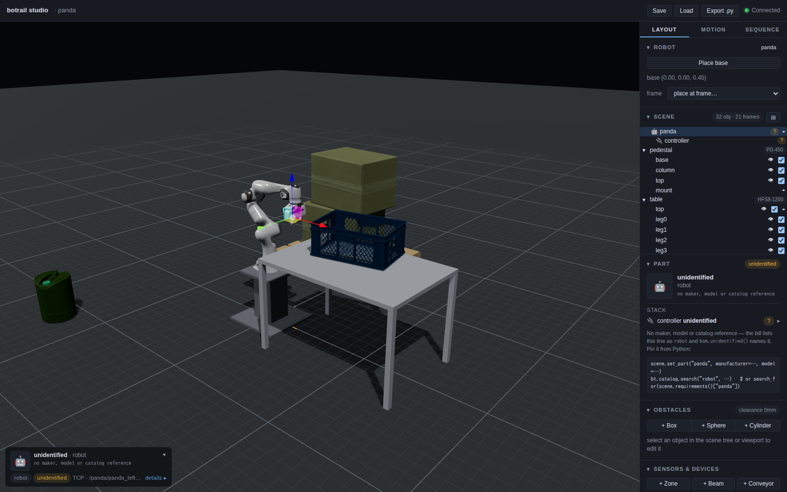
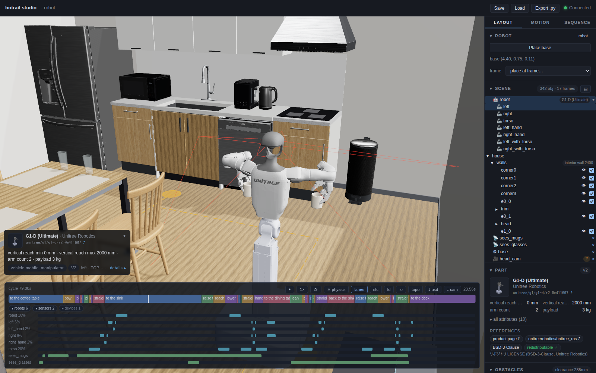

# USD import

botrail's environment format is USD. A stage becomes obstacles and named
frames in one call; a `UsdPhysics` articulation becomes a robot. Both are
normalized on the way in, so downstream code never thinks about units or up
axes again.

## Stages as environments

```python
names = scene.load_usd("cell.usda", prefix="env")
```

* **Formats**: `usda`, `usdc`, `usdz`. References, variants, and instancing
  are composed — you get the flattened result of the stage as authored.
* **Normalization**: everything arrives in **meters, Z-up**, whatever the
  stage's `metersPerUnit` and up axis say.
* **What imports**: the *static geometry*, as obstacles. This is deliberate —
  behavior (belts that run, sensors that trip) is authored in botrail, where
  it can be simulated deterministically. See
  [Sensors and devices](sensors-and-devices.md).
* **Names**: prim paths, optionally prefixed (`env/World/Table`). The call
  returns the added obstacle names.

The studio draws each imported prim as authored — normals, UVs, material
subsets and textures — while collision keeps its own decomposed geometry.
Moving the obstacle moves its appearance with it; `enabled`, `visible`,
`walkable` and a `set_obstacle_material` override stay scene state on top.
The appearance and the layers and images it references travel with a saved
project and with an exported USD's asset directory.

## Frames come along for free

Leaf `Xform`/`Scope` prims become named frames — poses with no geometry. This
is the load-bearing feature: author your mount points and teach points *into
the layout file*, and the cell logic reads them by name.

```python
scene.load_usd("factory.usda")
scene.set_robot_base_pose(*scene.frame("/World/MountFrame"))

pick  = scene.frame("/World/Conveyor/PickFrame")
place = scene.frame("/World/Pallet/PlaceFrame")
```

Move the pedestal prim in the USD and the robot moves with it; move
`PickFrame` and the pick re-teaches itself. The
[tutorial cells](../tutorials/pose-and-plan.md) run entirely on this pattern.

## Cameras come along too

A `Camera` prim in the stage becomes a [camera](sensors-and-devices.md#cameras)
of the scene — a world fixture named like the prim, standing where the prim
stands, with the authored optics: the film back (`focalLength` /
`horizontalAperture`) is the horizontal field of view, the aperture aspect
the image aspect, `clippingRange` the near and far clip in meters. USD
cameras carry no pixel count; a stage botrail exported says it in
`botrail:resolution` and imports back pixel-exact, anything else gets a
1280-pixel width and the aperture aspect. Omniverse's far clips of ten
million meters are capped at 100 m, with an import notice.

```python
scene.load_usd("cell.usda", prefix="env")
scene.camera_names            # ['env/World/Overview', ...]
scene.remove_camera("env/World/Overview")   # scene state like any other
```

A camera Omniverse hid with `visibility = "invisible"` still imports — that
only hides its gizmo, the camera still films. Orthographic cameras are
skipped with a notice; botrail's cameras are pinhole.

## Robots from USD

Articulations load through [`Robot.from_usd`][botrail.Robot.from_usd] — see
the [Robots guide](robots.md#three-ways-in) for the details (prim-path names,
degree/unit conversion, `articulation_root`, `search_paths`). USD-sourced
robots keep a pointer to their stage, which the exporter uses to reference the
original asset at full visual fidelity. A `Camera` prim under one of its
rigid bodies — an Isaac asset's head or wrist camera — is the robot's own:
adding the robot mounts it on that link as `<robot>/<prim name>`, riding the
joints, without the generic housing (the robot's geometry is the housing).
Remove one you do not want; the project and the generated script keep it
removed.

A tool that came from USD keeps its authored prims after `attach_tool`,
mapped onto the composite's links; `Robot.from_catalog(id, format="usd")`
picks a catalog product's USD where the package ships one. Materials are
read as `UsdPreviewSurface` — MDL or MaterialX networks will not look the
same — and layer and image references should be relative
(`../textures/panel.png`) so the asset directory an export writes next to
the layer stays portable.

A stage with rigid bodies but no physics joints — a coupling, a fingertip, a
static fixture — imports too: the bodies weld together at their stage poses
and the model comes out with zero DOF, a perfectly good scene citizen for
collision checking and [tool mounting](robots.md#mounting-a-tool).

## SimReady Central assets

NVIDIA's [SimReady Central](https://huggingface.co/spaces/nvidia/simready-central)
is an open library of simulation-ready OpenUSD assets — thousands of props
(cartons, crates, drums, carts, barriers, furniture, tools) and a few vendor
robots and grippers, each package in its publisher's Hugging Face dataset,
pinned to a dataset commit by the library's index, under the license the
publisher chose (NVIDIA's own 2,500-odd props are CC-BY-4.0). They are
ordinary stages to botrail: metres, Z-up, the geometry as obstacles, the
mass and the friction the package authored, the textures and MDL look in
the studio.

```python
hits = bt.simready.search("cardboard box", max_size=(0.8, 0.6, 0.6), license="CC-BY", limit=5)
hits[0].name, hits[0].size_m, hits[0].mass_kg, hits[0].caption
bt.parts.simready(scene, "carton", (1.2, 0.4), hits[0], yaw=0.3, dynamic=True)

pkg = bt.simready.fetch("https://huggingface.co/datasets/nvidia/simready-assets/"
                        "blob/653d91e182011f357cf1644013cc94ddf194d349/box_cardboard_a01/"
                        "simready_usd/sm_box_cardboard_a01_01.usd")   # or a link you kept
```



[`bt.simready.fetch`][botrail.simready.fetch] brings one package into the
`huggingface_hub` cache at its commit (without the CAD and MDL source copies
and the thumbnails) and says what it is — the root layer, the license, the
publisher. [`bt.parts.simready`][botrail.parts.simready] stands it in the
cell like any [prop](standard-parts.md): the stage's prims become obstacles
under `name/`, the footprint's middle lands on `(x, y)` and the underside on
the floor, the package's frames ride along, and one part pinned on the group
records the source URL at its commit and the license, so the
[BOM](parts-and-bom.md) says where the thing came from.

These assets are not catalog products. They carry no part number, no specs
and no mounting, and a dimension a cell verifies — an aisle width, a shelf
pitch — never belongs in a baked asset: use them for the scenery and the
fixed-size goods a cell is full of, and the [catalog](robots.md#the-model-catalog)
and the [standard parts](standard-parts.md) for what is ordered and measured.
A package whose doors and drawers are joints — a cabinet, a dishwasher, a
range hood — is a prop all the same: `bt.parts.simready` imports every body
of it at its authored pose (`load_usd(..., articulated="scenery")`), where a
plain `load_usd` leaves an articulated subtree to the robot importer.



`examples/home/home_tidy_demo.py` furnishes a 7.2 × 4.8 m
living-dining-kitchen with 18 packages from four publishers (NVIDIA, LG
Electronics, ForgeCAD and Palatial, CC BY 4.0 throughout) and has a catalog
Unitree G1-D clear the mugs off the coffee table and the glasses off the
dining table into the sink, the dishes held upright all the way. The
tables, the sink and the walls are built from parameters in
`examples/home/_house.py`: the dimensions the tidy-up depends on stay in the
cell's source, the furniture around them is the packages as shipped, and
the BOM lists every package with its URL and license.

A vendor robot or gripper from the library loads with
[`Robot.from_usd`][botrail.Robot.from_usd] (an articulation rooted on its
fixed joint, Isaac Sim's convention, is understood; a variant's retired
joints and a four-bar's loop-closure joints stay out of the tree; a PhysX
mimic names the joint's one dof whichever axis letter it was written
with), but the
cell keeps using it through the catalog, which adds the frames, the specs
and the mimic a gripper needs.

## Round trip

USD is also how animation leaves and re-enters botrail:

```python
tl.export_usd("cycle.usda", fps=60)          # bake a cycle out
scene.play_usd_animation("cycle.usda")       # play a recording back
```

The exported layer plays in usdview, Omniverse, or Blender with no botrail
installed; recordings — botrail's own, or an Isaac Sim capture — play back
into the studio through the same pipeline. Details in
[Export](export.md) and the
[Export and replay USD](../tutorials/replay-usd.md) tutorial.

!!! tip "Isaac Sim assets work as-is"

    The examples load NVIDIA's official Franka USD unmodified, and the factory
    cell is a hand-authored `usda` layer. If you already have Omniverse
    assets, they are your botrail cells too.
