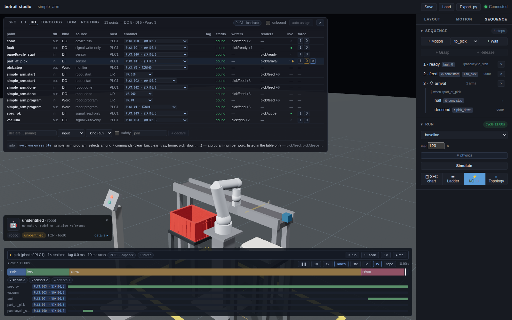
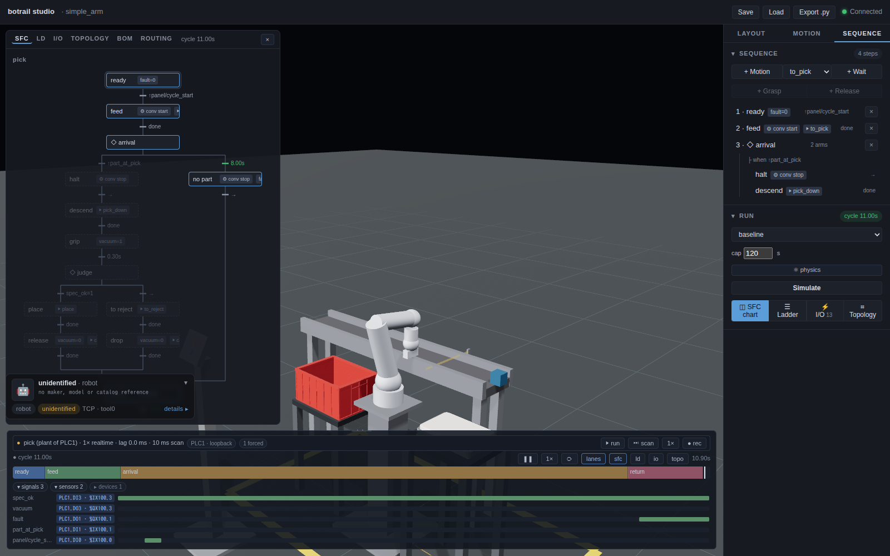

# Virtual commissioning: the cell as the plant of a PLC

[Offline commissioning](offline-commissioning.md) hands the control logic
over as PLCopen XML and compares the controller's log with the bake. This
page is the loop itself: the cell runs as the **plant** of a controller
outside it — a soft PLC, a PLC on the bench, botrail's own executor — the
controller writes the coils and reads the sensors, the cell moves, and the
result is the same `SequenceTimeline` the bake produces, so the studio, the
USD, the clearance report and `tl.diff` work on it unchanged.

Three things meet here. The **bake** is the trajectory the cell follows if
the controller behaves as designed; it does not change. An **emulation** is
the trajectory a controller actually drove the cell through; the plant side
is a pure function of its inputs, so a run is reproducible from the recorded
input stream. The **diff** names where the two part, by signal and by
second.

## The exchange

Nothing is authored for the connection. The [I/O map](io-map.md) already
knows every point's name, host, direction, type, binding and address, and
the PLCopen export declares its variables from the same points. The
**exchange** of a host is that half of the map turned to the plant's side:

```python
xc = bt.vc.exchange(scene, "PLC1")      # what the controller writes and reads
print(xc.to_markdown())                 # points, variables, types, addresses, initial values
xc.save("cell_exchange_PLC1.csv")
```

* **inputs** of the plant — the controller writes them: coils (`BOOL`),
  device commands (`REAL` speed and position, `INT` station), a robot's
  `start` and `program` word;
* **outputs** of the plant — the controller reads them: sensors and limit
  switches, a device's in-position contact, a robot's `done`, handshake
  signals other programs write.

A relay written and read on the same host never crosses (it is the
controller's own memory); a magazine stays cosmetic unless you declare it an
output. `xc.entries` is the **robot command table**: on a robot the host
drives from outside its controller, every command — a motion, a ramp, a
grasp — has a number the `program` word selects; motions keep the PLCopen
numbering. `xc.parameters` are the constants a bus cannot carry live (an
indexed conveyor's pitch). The variables, types and addresses are exactly
the PLCopen file's; a test pins the two together.

## The program, as the runtime compiles it

`scene.plcopen()` is the SFC for the IDE; `scene.st(host)` is the same logic
as **Structured Text** a runtime compiles by itself (OpenPLC's matiec,
Beremiz, CODESYS, the IDEs that read ST but not PLCopen XML): one `BOOL`
per step, the transitions as `IF step AND condition` blocks in authored
order, the exchange's points as located globals with the PLC's addresses,
and the handshakes written for a polled link:

```python
scene.export_st("pick_PLC1.st", "PLC1")      # PROGRAM pick … CONFIGURATION Config0 / RESOURCE Res0
```

A robot command is posted by the step with the `program` word, **issued
once the robot reports ready** (`start` raised while `done` is high) and
**held until the robot reads busy** (`done` low — the plant holds `done` low
once it has taken the command), then dropped; the step completes on
busy-then-done. That is what a controller polling the plant every 20–100 ms
needs: a level dropped by the step's exit alone would be read as "done"
before the command was ever taken, a one-scan pulse would be missed, and a
`start` raised against an input image the controller has not read yet (the
power-up scans, before the first poll) would be dropped as "taken" before it
was ever sent — the OpenPLC run lost its first motion to exactly that until
the ready test was added. Edge triggers are called every scan at the top of
the program, so an edge raised while another step was active is remembered
the way the bake remembers it.

## Running the plant

A `Session` opens the cell as the plant of the hosts in `links` (or of a
host run in loopback), asks each link for its writes before every scan,
applies them at the host's slot in the scan order, and scans:

```python
# Loopback: botrail runs the host's own programs, but every action they
# fire crosses the exchange and comes back — the reference run, equal to
# the bake bit for bit.
with bt.vc.loopback(scene, ["pick"], host="PLC1") as s:
    s.run()
    assert s.timeline().signals == bake.signals
    rec = s.recording()                            # every input, with its time

# Replay: the recorded inputs fed back with the host external.
with bt.vc.Session(scene, ["pick"], links={"PLC1": bt.vc.replay(rec)}) as s:
    s.run(for_=bake.duration)

# A controller on the wire, in wall-clock time.
link = bt.vc.modbus_server(xc, "0.0.0.0:5020", allow_remote=True)   # the PLC polls botrail
with bt.vc.Session(scene, ["pick"], links={"PLC1": link}, pace="realtime", cycle=True) as s:
    s.run(for_=60.0)
    print(s.stats())                               # scans, lag behind the wall clock, overruns
    d = bake.diff(s.trace(), tolerance=0.1, align_on="conv")
```

Two links come with the package (`pip install "botrail[vc]"` brings
`pymodbus` and `asyncua`):

* **`bt.vc.modbus_server`** — botrail is a Modbus TCP server, the virtual
  remote I/O station the PLC polls: the plant's outputs are discrete inputs
  and input registers, its inputs coils and holding registers, numbered
  from the exchange's IEC addresses (`%IX100.3` → discrete input 3 with
  `iec_base=100`, where OpenPLC maps a slave device). `register_map()` is
  the table the PLC side is configured from.
* **`bt.vc.opcua_client`** — botrail is an OPC UA client of the
  controller's server (PLCSIM Advanced, TwinCAT, CODESYS, an OpenPLC
  plugin): it writes the plant's outputs to the nodes the controller reads
  and subscribes to the nodes the controller writes; `nodes=` maps a
  point's label to its NodeId when the default `ns=<n>;s=<tag>` is not it.

Both bind to this machine unless told otherwise (`allow_remote=True`): the
plant is for a controller **under test**, never a plant floor. `cycle=True`
starts the programs the plant scans itself (a machine's own program) over
when they end, as a cycling controller outside expects; `pace="realtime"`
paces the scans to the wall clock (`speed` scales it), `sync` and `free`
run as fast as the loop goes.

The session records every write the controller makes, with its time
(`recording()`, saved as CSV or JSON); `replay` reproduces the run without
the wire, deterministically. The live run itself is not repeatable — a
controller's write lands at the next plant tick, as on a real bus, and
which tick depends on timing — so the diff carries a tolerance of a few
polling periods.

## A hand on the wire

```python
s.force("part_at_pick", True)                 # a PLC force: the lane is pinned until unforce
s.inject(bt.io.open("spec_ok"), at=bt.vc.rising("part_at_pick"))   # a wire that opens at that edge
s.run(until=bt.vc.level("vacuum", True), timeout=30.0)
```

`force` / `unforce` pin a sensor, an internal signal or a device's running
state; `inject` takes the same faults a scenario does (`bt.io.stuck`,
`open`, `node_down`), now, on a lane's rising edge, or when a program the
plant scans enters a step. Anchored faults take hold before the programs
scan the tick in which the plant observes the anchor.

The session is also the transport of the run. `pause` holds the plant
where it stands — the controller keeps polling a frozen world, and its
writes wait for the next scan — `resume` lets it go, `step(n)` scans `n`
times and holds again, and `speed` scales a realtime run. `break_on(lane)`
pauses the scan the lane rises (`rising=False` for its fall), and
`halted` says which breakpoint stopped it. `press(lane)` pushes a panel
button: the lane is forced high for `PRESS_HOLD_S` plant seconds and
released, long enough for a polled controller to see the edge.
`record()` / `stop_record()` cut a **clip** — the stretch since `record`
as a `SequenceTimeline` of its own, starting at zero, playable and
exportable like any bake; `tl.clip(start, end)` cuts the same stretch out
of any timeline (one cycle of a long run). Holding and stepping never
touch the plant's clock: a loopback run paused and stepped is still the
bake, bit for bit.

## In the studio: the live plant

With a [studio](studio.md) open on the scene, a session streams there as
it runs — the dock follows the plant's head, the bands and lanes grow, the
SFC chart's token rides the active step — and the studio is a hand on the
plant in return. Everything the dock sends is one of the session's own
commands, applied before its next scan:



* the **plant bar** over the transport names the run and its controllers
  (`PLC1 · modbus 127.0.0.1:5020 · 2037×`, red when a link is down), the
  pace and the lag, and holds the transport: **❚❚ hold** / **▶ run**,
  **⏭ scan** (one scan), the realtime **speed**, **● rec** — a clip
  recorded from here lands on the dock when stopped, playable and
  **⤓ usd**, while the plant runs on; **live** follows it again;
* the **I/O table** gains the controllers' chips and a **force** column:
  `1` / `0` pin a lane like a PLC force, `×` releases it, and a forced row
  reads as the PLC paints it (an `F` beside its live level);
* a **right-click on a lane's name** sets a breakpoint on its rising edge
  (shift: falling); the lane wears `↑` / `↓`, and when the edge lands the
  plant holds and the bar says *paused at ↑part_at_pick at 12.34 s*;
* a **push button** of an [`operator_panel`](standard-parts.md) is pressed
  by clicking it in the viewport — its lane goes high for the session's
  hold time — and the panel's **lamps** (`lamps={"fault": "red"}`,
  `scene.add_lamp` for one on anything else) light in their colour while
  their signal is on, in a live run and in a played-back bake alike.

The live past is not kept in the browser beyond a moment (the bands and
lanes are whole, the 3D replay is the last two seconds and the head); the
session keeps the whole run and publishes it to the dock when it ends.

### The controller's own steps

A PLC under test runs its program itself, so the plant has no step bands
for it — unless the controller says where it is. `monitor=True` on the
PLC's node makes it report the active step of every program it runs as one
word per program (`pick.step` on the exchange, `INT`, `-1` when parked):
the ST export writes the step's index into it on every transition, and
the plant records the word as the program's step bands and its decisions,
so the SFC chart, the ladder and the dock show the PLC's program the way
they show the cell's own — which arm it took, when, from the PLC's own
mouth rather than inferred.

```python
scene.add_io_node("PLC1", kind="plc", programs=["pick"], monitor=True,
                  channels=bt.io.di8(base="%IX100.0") + bt.io.do8(base="%QX100.0") + bt.io.word(count=3, base="%QW100"))
```



## A grasp that follows its coil

A PLC has no "attach" command. It energises the vacuum valve or the
gripper solenoid, and the part comes along because the tool holds it. The
cell says the same with `bind_grasp`: the grasp is the coil's, on the
plant's side of the wire.

```python
scene.define_signal("vacuum")
scene.bind_grasp("vacuum", parts=["part"])           # the coil takes `part`, and lets it go
scene.bind_grasp("suction", reach_m=0.02)            # or: whatever comes within 2 cm of the tool
```

While the signal is high the tool takes the nearest candidate part — the
ones named in `parts`, or any enabled obstacle nobody holds — within
`reach_m` of its surface; when it falls, the tool releases what it holds.
Every edge counts, whoever made it: a step's `set_signal`, a controller's
coil write on the wire, a force on the lane. A sequence on a bound tool
writes the coil and never `attach`es (an authored attach there is refused),
so the exchange carries the coil and nothing else, the PLCopen and ST
exports call no grasp block, and a controller under test drives the pick
with the same two bits it drives on the floor. With `reach_m` the coil is a
level: a cup energised on the way down takes the part the tick it touches,
and energised over an empty station it takes nothing — which the diff then
shows as a part that never moved. Without `reach_m`, the nearest named part
is taken on the rising edge wherever it stands, as an authored `attach`
would; one of the two is required. The exchange notes the binding on the
coil's row, and the ST export on its located global.

## Tests as a table: the FAT

A factory acceptance test is a sheet: *get the cell here, do this to it,
and this must follow*. `bt.vc.TestCase` is one such row and
`bt.vc.run_fat` fills the sheet in — the same `FatReport` whether the
cases ran **offline** (botrail's own executor, in loopback over every host
of the cell, bit for bit the bake) or **online** (a controller on the
wire through the links above):

```python
cases = [
    bt.vc.TestCase("TC-01 cycle", expect=[bt.vc.cycle_within(12.0), bt.vc.clearance(0.02)]),
    bt.vc.TestCase("TC-07 beam open",
                   faults=[bt.io.open("part_at_pick")],           # what goes in …
                   at=bt.vc.step("pick", "await part"),           # … and when
                   expect=[bt.vc.never("vacuum", during=10.0),    # what must follow
                           bt.vc.stalls("pick", at="await part")]),
    bt.vc.TestCase("TC-12 start with the door open",
                   forces={"door_closed": False}, press=["panel/cycle_start"],
                   at=bt.vc.elapsed(0.5), expect=[bt.vc.no_motion(), bt.vc.stalls()]),
]
fat = bt.vc.run_fat(scene, cases, ["pick"])            # offline: every case a loopback run
fat.save("cell_fat.md"); assert fat.ok                  # .md / .csv / .json
fat = bt.vc.run_fat(scene, cases, ["pick"], links={"PLC1": link}, horizon=20.0)   # the same sheet, the PLC driving
```

A row names its **moment** (`at`: a step entered, a lane's edge, a level,
a time — the first scan when left out), what goes in there (`faults` are
the scenario faults `bt.io.stuck / open / node_down`; `forces` pin
lanes; `press` pushes panel buttons), how long it runs on (`until` a
predicate, `for_` seconds, or until the programs end — capped by the
`horizon`, 1.5 × the bake + 1 s by default), and the **expectations** over
the window from that moment to the end of the run:

| expectation | holds when |
|---|---|
| `rises(lane, within=)` / `falls(lane, within=)` | the lane takes that edge within the time |
| `never(lane, during=)` | the lane is never high in the window |
| `never(bt.vc.step(program, step), during=)` | the program never enters the step |
| `held(lane, value, for_=)` | the lane holds the level, no edge in between |
| `step_reached(program, step, within=)` | the program enters the step (any of a list) |
| `stalls(program=, at=)` | the cycle is refused: the program has not ended when the run ends, standing at `at` |
| `no_motion(robot=, during=)` | no robot moves in the window |
| `clearance(min_m, to=)` | the minimum clearance over the window stays above `min_m` |
| `cycle_within(seconds, program=)` | the program(s) run to their end within the time |
| `check(fn, label)` | `fn(timeline, t0, t1)` says so — the escape hatch |

Every expectation reads the **timeline the run recorded**, so what is
checked is what the studio shows and the USD carries; the report keeps
each row's timeline (`fat.timelines[name]`) as the evidence behind a red
one. `given=[...]` are preconditions: a row whose setup never took — the
moment did not come, the gate was never reached — is reported *n/a*, not
failed, and so is a check on something the run cannot show (an external
controller's step with no monitor word). Online, name steps that last: a
step the controller enters and leaves in one scan never shows in a polled
monitor word, so judge the arm it took by what it switched. `fat.ok` is
"no row failed".

### Rows nobody writes

The interlock table is a list of *output × condition*, so it is a list of
tests. `bt.vc.interlock_tests(scene, "pick")` turns each row into a case:
the condition pinned false from the first scan — the table itself names
the lanes and levels (`denial`: a level test on high pinned low, a rising
edge pinned low, one term of an AND, every alternative of an OR) — the
program expected to reach the gate (the step before, as `given`) and
**never** to enter the step that switches the output. Rows nothing can
pin (a timer, motion completion, device or robot feedback, a first step
that is entered at start) are carried as n/a with the reason, so the
sheet still has one row per table row. `bt.vc.safety_tests(scene)` adds a
row per safety input the programs read (`safety=True` on its declaration
or binding): pinned to the level that denies the program's test of it,
the cycle must stall.

The cases are plain data, so the rows derived from the **design** run
against whatever **implements** it. Run them against the same cell with
one transition dropped and exactly that gate's rows turn red; run them
against the PLC's own program (its steps seen through the monitor word)
and a missing interlock shows up as the row it would have been. In the
machine-tending demo the three FAT rows a control designer wrote by hand
— door switch stuck, CLAMP wire open, E-stop in — are test cases whose
verdict is `stalls(vmc, at="wait_start")` /
`at="wait_clamp"`, the same verdict the scenario matrix gave them, now
with the guard named.

### The sheet as a file

Cases live in Python or in a `.yaml` / `.json` file with the same shape
(`bt.vc.load_cases`, `cases_from_data` / `cases_to_data`):

```yaml
cases:
  - name: TC-07 beam open
    faults: [{open: part_at_pick}]
    at: {step: [pick, await part]}
    expect:
      - never: vacuum
        during: 10.0
      - stalls: {program: pick, at: await part}
  - interlock_tests: pick        # the derived rows, spliced in
  - safety_tests: true
```

`botrail fat cell.py [--cases fat.yaml] [--link …] --out fat.md` runs the
sheet from the shell (exit 1 on a red row); `botrail export … --fat` and
`bt.export_cell(scene, out, fat=True)` put it in the document set as
`<name>_fat.md` / `.json`, and `scene.cell_report(...,
sections=[fat.section()])` into the cell report. The sheet is the
deliverable; pytest keeps the `assert`s.

## A PLC under test: the OpenPLC demo

`examples/commissioning/openplc_pick_cell/` runs the pick cell against
OpenPLC v3 in Docker: `compose.yaml` starts the runtime on the host's
network (the PLC dials botrail on loopback — nothing is opened to the
outside), `run_demo.py` writes the PLC's program as ST from the cell, hands
it to OpenPLC over its web API, registers botrail as the PLC's Modbus slave
device, starts the PLC, runs the plant in wall-clock time and diffs the run
against the reference run — the cell's own logic running on a real IEC
61131-3 runtime, against the cell as its plant. The cell has an operator
panel (a start button the cycle waits for, a fault lamp) and a timeout arm;
the reference is botrail scanning the same program in loopback with the
start pressed at the same moment. The cell grasps by its coil, so the PLC
picks and places the part with the vacuum bit and the motion numbers
alone, it reports its step in a word, and every signal of the run lands
within a few polling periods of the reference. `--studio` streams the run
to the studio, `--manual` leaves the start button to you (click it), and
`--force-beam` forces the beam low so the PLC runs its timer out and takes
the fault arm — visible on the SFC chart from the PLC's own step word.
`--fat` runs the cell's [FAT sheet](#tests-as-a-table-the-fat) against the
PLC instead of one scripted cycle — the nominal cycle, the beam dark, no
start — the PLC stopped and started for every row, and the same rows hold
offline in loopback. The arm comes over the halted part, down onto its top
face, takes it on the vacuum coil and sets it on the tray's insert; the run
reports where the part went down against the reference (6–7 mm with 20 ms
polling: the belt halts a poll later, and the part is carried with that
offset) and `--check` holds it to 10 mm.
`--check` makes it a CI job (`.github/workflows/commissioning.yml`,
nightly). The command line does the same for any cell:

```text
botrail export cell.py --out deliverables/ --exchange PLC1 --st PLC1
botrail commission cell.py --link PLC1=modbus://0.0.0.0:5020 --cycle --for 60 --record out/ --diff
botrail commission cell.py --link PLC1=replay:out/cell_inputs.csv --diff
botrail fat cell.py --cases fat.yaml --link PLC1=modbus://0.0.0.0:5020 --horizon 30 --out fat.md
```

## The robot controller in the loop

Everything above drives the arm with botrail's own planner and timing, and
the controller under test is the PLC. The other way round is the **robot's
own controller** under test: its program is botrail's export, it runs on
the controller, and botrail is the plant around it — the sensors it reads,
the coils it writes, the belt, the part, the grasp — while the controller's
**joints stream in** and the plant mirrors the arm as the controller moves
it, still watching collisions, clearance and handshakes. Fidelity level 2
of §4.8: the controller's own motion timing, with the cell unchanged.

The free way to do it is URSim, the Universal Robots controller simulator,
in Docker. The pick program leaves as URScript whose I/O lives in the
controller's **general-purpose bit registers** — the ones an external RTDE
client reads and writes (64–127; 0–63 belong to the fieldbus interfaces) —
and `bt.vc.ursim` is that client:

```python
scene.add_io_node("UR", kind="robot_controller", robots=["arm"], channels=bt.io.ur_registers())
scene.bind_input("part_at_pick", "UR", "IR64")      # what the program reads: input registers
scene.bind_output("vacuum", "UR", "OR65")           # what it writes: output registers
runs = scene.simulate_scenarios(["pick"])
script = runs.to_script(sequence="pick", rtde=True)  # read_input_boolean_register(64) / write_output_boolean_register(65, …)

dash = bt.vc.UrDashboard("127.0.0.1"); dash.prepare()               # power on, brakes off
link = bt.vc.ursim(bt.vc.exchange(scene, "UR"), "127.0.0.1", robot="arm")
with bt.vc.Session(scene, ["pick"], links={"UR": link}, pace="realtime") as s:
    s.tick(); dash.run_script(script)                               # the controller runs the program
    s.run(until=lambda s: link.runtime_state == "playing", timeout=20.0)
    s.run(until=lambda s: link.idle, timeout=60.0)                  # … to its end
    tl = s.timeline()
```

The link's `robots=` makes the session **stream** that robot: the plant
opens with `joints=[robot]`, takes the controller's `actual_q` as the arm's
joints every scan (a mirror, no rate limit of botrail's), and takes the
controller's `runtime_state` as the robot's idle word — the `done` contact
other hosts read, and what a `robot_done` wait on the plant side sees
(`LiveRollout.report_idle`). Everything else is the ordinary plant: the
beam trips because the belt the program switched on carried the part, the
vacuum coil the program wrote takes the part by its grasp binding, the run
is a timeline, the diff names what moved when.

What the diff measures here is the **controller's timing against the
bake**: botrail planned and timed the moves one way, the UR controller
re-times the same joint targets its own way, so the edges land seconds
apart, not milliseconds. `examples/commissioning/ursim_pick_cell/run_demo.py`
reports it move by move — when the bake reached each goal, when the
controller's arm did — and a `--tolerance` of a few seconds is the honest
setting for the diff. Measured against URSim 5.25 (UR5, the exported
program at the controller's default speeds, a fresh container): the bake's
cycle is 11.35 s, the controller's 15.36 s. Most of that is the first move —
the arm starts wherever the simulator booted it, not at the cell's ready
pose — so the controller reaches the pick pose 2.9 s after the bake and
every later goal 3.1–3.6 s after it; once the diff aligns the two clocks on
the belt's first edge every signal lands within 0.47 s (the vacuum, after
the controller's own grip timer), and the part goes down 2.4 mm from where
the bake set it. The number that moved is the robot's, not the cell's —
which is what a level-2 run is for.

Where the cell moves in a straight line (a `cartesian_line` segment), the
script says `movel`, and a straight line is the controller's own: it
interpolates in its Cartesian space with its own inverse kinematics. Joint
targets taught on another arm transfer verbatim only while that stays clear
of the controller's singularities. At `wrist_2 = 0` a UR's last two axes
line up, and a `movel` there flips the wrist and ends in a protective stop
(C204A1); the pick cell teaches every pose with that joint a quarter turn
round for this reason. `UrDashboard.prepare` unlocks a protective stop a
previous program left behind, since the controller will not start the next
one while it stands.

### Vendor interfaces as data

A PLC drives a robot through wires the vendor names — FANUC's UOP
(`PROD_START`, `PNS1-8` + `PNSTROBE`, `PROGRUN`), KUKA Automatic External
(`$EXT_START`, `PGNO` + `PGNO_VALID`, `APPL_RUN`), ABB System I/O (`Start at
Main`, `Cycle On`), Universal Robots' remote-control inputs. botrail's
handshake has the same three parts (rule ⑥ of the I/O map: a `start`
pulse, a `program` word, a `done` contact), so a vendor interface is a
mapping onto the controller node's channels, with the vendor's name,
polarity, edge and pulse width — **data**, in `bt.vc.interfaces`:

```python
scene.add_io_node("RC1", kind="robot_controller", robots=["arm"], channels=bt.io.fanuc_uop())
uop = bt.vc.interfaces.fanuc_uop_pns(programs={"pick": 1})
uop.apply(scene, "arm", "RC1")     # arm.start → UI18 PROD_START (falling edge, pulse ≥ 100 ms), arm.program → PNS, arm.done → UO3 PROGRUN
print(uop.to_markdown())            # the interface sheet: every signal, polarity, edge, timing
print(tl.handshake_spec())          # the robot lines now carry the vendor's names and timing
```

`bt.io.fanuc_uop()`, `kuka_automatic_external()`, `abb_system_io()` and
`ur_standard()` are the channel sets; `fanuc_uop_pns`, `kuka_automatic_external`,
`abb_system_io` and `ur_remote` the templates. `apply` writes the mapping
into the I/O map as bindings (tag, polarity, note), from where the I/O
list, the exchange table and the handshake specification carry it; the
engine keeps its generic handshake. The numbers are the manuals' standard
assignments and the usual PLC timings — check them against the
controller's own I/O configuration. A template-driven handshake *shape*
(FANUC's falling-edge start, the PNS strobe and acknowledge sequence) in
the exported PLC code is the next step, not this one.

## The device vocabulary: words, cylinders, stoppers

A PLC program speaks in more than coils and contacts. The words it writes
and reads, the pneumatics it drives, the belts that hold parts — this is
the vocabulary botrail's plant answers in (design-virtual-commissioning.md
§4.7, VC6), and none of it is authored for the connection: the I/O map
derives it, the exchange carries it, the ST and PLCopen exports write it.

**Words.** Besides its signal lanes a bake records **word lanes** — numbers
as step functions, named like exchange points, `name.aspect`:

```python
scene.add_linear_axis("feed", ["strip"], axis=(1, 0, 0), speed=0.25, range=(0, 0.4), encoder=True)
scene.add_conveyor("belt", zone_position=..., zone_size=..., velocity=(0.5, 0, 0), encoder=True)
scene.add_zone_sensor("eye", position=..., size=..., watch=["a", "b"], ids={"a": 7, "b": 3})

tl = scene.simulate_sequence("index")
tl.word("feed.encoder").max()        # the axis's position (m); a belt's is its travel since t = 0
tl.word("eye.id").samples            # [(0.0, 0), (1.25, 7), (1.65, 3), ...] — the smallest id the reader sees, 0 for none
s.word("belt.encoder")               # … and the live value on a session
```

An **encoder** (`encoder=True` on an axis or a belt) is derived as a
feedback word on every host that commands the device; an **identification
reader** (a zone sensor with `ids=`) is a word no botrail program can read
yet, so it reaches a controller by declaration —
`scene.declare_io("eye.id", role="input", host="PLC1")` — the point a
hand-written PLC program will branch on. The studio draws word lanes as
step plots beside the sensor lanes, the value under the playhead next to
the name.

**Units.** A measurement is a REAL and a PLC's register is 16 bits. Give
the word channel a unit and the exchange scales the point to an INT in it:

```python
scene.add_io_node("PLC1", kind="plc", programs=["index"],
                  channels=bt.io.di8(base="%IX100.0") + bt.io.do8(base="%QX100.0")
                  + bt.io.channels("word", 2, prefix="QW", base="%QW100", unit="mm")
                  + bt.io.channels("word", 2, prefix="IW", base="%IW100", unit="mm"))
scene.bind_output("feed.position", "PLC1", "QW0")   # feed_position AT %QW100 : INT  — `feed_position := 300; (* 0.3 m *)`
scene.bind_input("feed.encoder", "PLC1", "IW0")     # feed_encoder AT %IW100 : INT  — the plant writes round(x · 1000)
```

The plant divides on the way in and multiplies on the way out; the
exchange table says `INT (mm)` and notes that the controller's targets
round to the unit. A REAL left on a word channel without a unit is a
`unit` finding (OpenPLC would reject the declaration).

**Cylinders.** A pneumatic cylinder is a linear axis with **coils**: each
coil names the stop it drives to, and a stop no coil names is the
spring-return position.

```python
bt.parts.cylinder(scene, "press", (0.2, 0, 0.55), axis=(0, 0, -1), stroke=0.03, time=0.3,
                  solenoid="double", pad=(0.03, 0.03, 0.01))
sq.step("press", actions=[bt.seq.move_to("press", "extended")], transition=bt.seq.device_done("press"))
```

The controller sees exactly what the valve and the switches give it: the
coils `press/extend` and `press/retract` (one, `press/extend`, for a single
solenoid), the limit switches `press/extended` and `press/retracted` — four
points, no position word. `move_to` writes the coil levels, `device_done`
waits on the switch of the stop the step commanded, and a coil dropped on a
single-solenoid axis springs it back. The loopback through the coils is the
bake, bit for bit.

**Stoppers.** Parts on a belt stop against an obstacle flagged a *stopper*
and queue behind one another in front of it, deterministically and from the
front; a blade lowered out of their path lets them by.

```python
bt.parts.stopper(scene, "stop1", (1.0, 0, 0.5), blade=(0.02, 0.2, 0.04), raised=True)   # a single-solenoid cylinder under the belt
scene.set_obstacle_stopper("end_plate", True)                                            # or any obstacle: a belt's end plate
```

The signal tower — `bt.parts.tower_lamp(scene, "tower", (x, y, 0), tiers={"green": "running", "red": "fault"})`
— is the lamp of VC3 stacked: each tier lit while its signal is on.

`examples/commissioning/openplc_feed_line/run_demo.py` is the judgement for
all of it: a feed axis under a press cylinder, indexed three times by
OpenPLC writing the target position in millimetres into a holding register,
reading in-position back, driving the press through its coils and
switches, with the encoder word in an input register and a signal tower on
`running` / `fault`. The reference is the same program in loopback; the run
reports the positions the PLC wrote (`[100, 200, 300, 0]` mm), the encoder
lane and the diff of every signal. Measured against OpenPLC v3 at 20 ms
polling: every edge of the seven signals present, the controller lagging
the bake by 0.13 s more per index — eight polled hops an index, a polling
period each — 0.41 s at the end of the cycle, within the cumulative
tolerance the run sets (two polling periods per hop over the whole cycle).

Two things the run taught the exports. A polled controller reads a *done*
contact from an image refreshed after the scan that wrote the command, so a
`device_done` wait straight after a `move_to` would fall through on the
previous command's done: the ST and PLCopen exports wait on `busy AND done`,
where `busy` is seeded false when the command changes something (true when
it changes nothing — an axis already at its target) and latches once the
plant reports not-done. And a cylinder's done is the switch of the stop it
was *last* sent to, tracked across steps, not the switch of the step that
happens to wait.

## What it is not

botrail never drives real actuators: it writes a controller's inputs, in a
test setup. It does not emulate a fieldbus device (PROFINET, EtherCAT,
EtherNet/IP implicit I/O) — the controller reaches the plant over Modbus or
OPC UA, or through a gateway. A robot whose own controller is the external
host is moved by that controller's joint stream (`bt.vc.ursim`, RTDE) or
not at all: without a stream, keep the robot's controller internal and let
the PLC drive it by handshake, which is how a cell is wired anyway. A kinematic
`attach` that is not bound to a coil still crosses the exchange as a
numbered robot command — a polled controller cannot reproduce it, so bind
the grasp.
