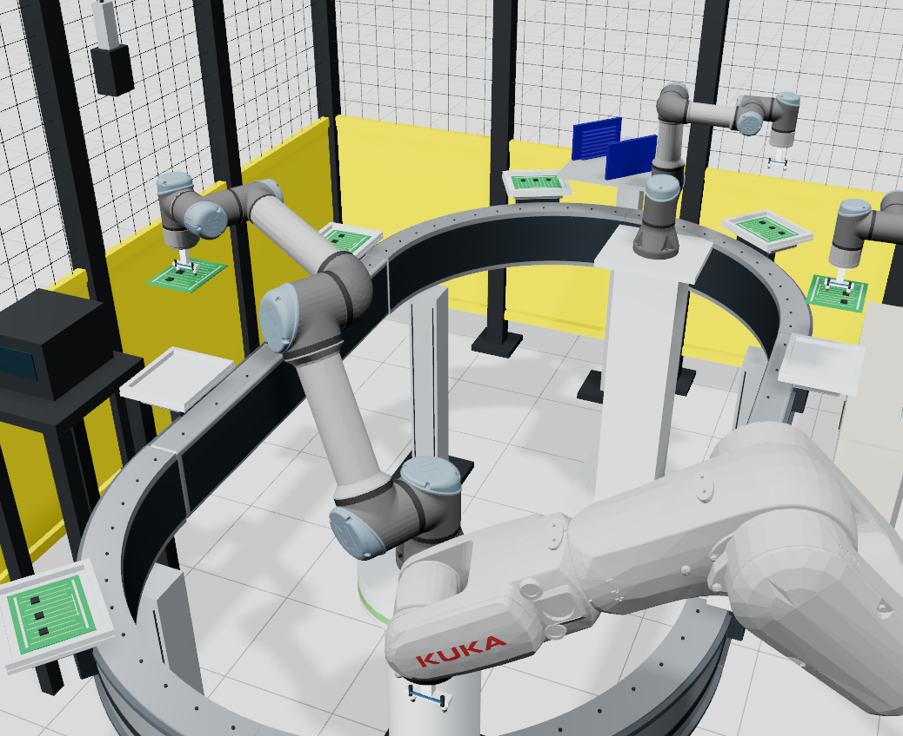

# PCB循環搬送セル



参照画像の黄黒の囲い、水平の楕円搬送路、アルミ製キャリア上の緑の基板、
中央・奥・右端のUR、右手前の白いKUKA、青いマガジン、左側の検査装置を
再構成するデモです。画像だけでは型式や寸法を確定できないため、見た目と用途が
近い実在製品を選び、製品モデルとセル固有の設計を分けています。

4台には次の役割を割り当てています。台車は、奥 → 左 → 手前 → 右の順に搬送します。

| 工程 | ロボット | 動作 |
|---|---|---|
| ① 基板供給 | 奥のUR3e `ur_feed` | 青いマガジンから上の基板を取り、空の台車へ載せる |
| ② 外観検査 | 中央のUR5e `ur_aoi` | 基板をカメラの下へ運び、横に走査して部品の有無を判定し、台車へ戻す |
| ③ 電気検査 | 手前のKUKA `kuka_test` | 基板を検査治具へ置いて手を離す。クランプを閉じて検査し、開いてから台車へ戻す |
| ④ 仕分け | 右のUR3e `ur_sort` | 2種類の検査結果を読み、緑の良品ラックまたは赤の不良品ラックへ取り出す |

工程別の撮影画像:
[①供給](../../docs/assets/studio/pcb_loop_feed.png) ·
[②外観検査](../../docs/assets/studio/pcb_loop_aoi.png) ·
[③電気検査](../../docs/assets/studio/pcb_loop_electrical.png) ·
[④不良品の排出](../../docs/assets/studio/pcb_loop_sort.png)

## 実行

既定では[公開カタログ](https://huggingface.co/datasets/botrail/botrail-catalog)から
KUKA、搬送路・台車、UR、吸着パッド、制御盤を取得します。

```bash
# botrail のルート
.venv/bin/python examples/assembly/pcb_loop_demo.py --studio
```

モデルを変更する場合は、`botrail-assets` と `botrail-catalog-builder` を使って
ローカルビルドし、`--catalog-root ../botrail-catalog-builder/build` を指定できます。
指定先にないパッケージは公開カタログから取得します。

既定のカメラは参照画像に近い切り取りです。`--overview` でセル全体を表示します。
工程全体の確認には `--studio --overview` を指定してください。
StudioのSequenceタブで再生・停止・時刻移動ができます。
全8枚の計算済み動作は約191秒です。`Simulate` で再計算するときや `.botrail` を
読み込んで計算するときは、Sequenceタブの `cap` を **400 s** に設定してください。
[全体図](../../docs/assets/studio/pcb_loop_overview.png)と
[Studio画面](../../docs/assets/studio/pcb_loop.png)も参照してください。

```bash
.venv/bin/python examples/assembly/pcb_loop_demo.py pcb_loop.usdc \
  --project pcb_loop.botrail --report pcb_loop.json
```

USDには30 fpsの動作を出力します。`.botrail` は編集・再実行用のプロジェクトです。
`--boards 1` なら1枚を全工程に通します。既定の8枚では、空の台車から開始し、
14回のインデックス送りで全基板を排出して停止します。`--cycles` は `--boards` の
別名です。以前の仮工程の「周回数」とは意味が異なります。
`BOTRAIL_CATALOG_BUILD` でもローカルカタログの場所を指定できます。

画像は `.venv/bin/python scripts/docs_screenshots.py pcb_loop` で再生成できます。
撮影にはNode.jsとPlaywrightのChromiumが必要です。
`feed`・`aoi`・`electrical`・`sort` の工程別カメラもシーンに含めています。

## 機器と出所

| 配置・用途 | 参照製品 / カタログID | モデルの扱い |
|---|---|---|
| 中央のアーム | UR5e / `universal_robots/ur/ur5e/r2` | 既存のUR製品モデル |
| 奥と右のアーム | UR3e ×2 / `universal_robots/ur/ur3e/r1` | 既存のUR製品モデル |
| 右手前の白いアーム | KUKA KR 6 R900-2 / `kuka/agilus/kr6-r900-2/r1` | upstream ROSメッシュ・関節定義を使用 |
| 搬送路 | ATS SuperTrak HORIZON10 / `ats/supertrak/horizon10-curve90/r1`、`horizon10-straight1000/r1` | 公開仕様を参照した独自形状。90°曲線4個、1000 mm直線2個 |
| 台車 | `ats/supertrak/horizon10-shuttle/r1` ×8 | 独自の参照形状にPython製の基板ネストを装着 |
| 吸着 | Schmalz PFYN 6 ESD / `schmalz/pfyn/pfyn-6-esd/r1`、各アーム2個 | カタログのパッドとSI設計ホルダ |
| 制御盤 | UR e-Series、KUKA KR C5 micro | 対応する既存スペックパックを使用 |

製品の参照元:

- [UR5e・UR3eの使用したROS記述](https://github.com/ros-industrial/universal_robot/tree/39ad110d8f2e8f66856a201cca88aa7a7025e3eb/ur_description)
- [KUKA KR AGILUS](https://www.kuka.com/en-us/products/robotics-systems/industrial-robots/kr-agilus)、[使用したROS記述](https://github.com/kroshu/kuka_robot_descriptions/tree/d2fa4377b77b7370cdcf6e52b430fc514a0eef19/kuka_agilus_support)
- [SuperTrak HORIZON10仕様・構成](https://supertrakconveyance.com/products/supertrak-horizon10/specs-components-configurations/)

KUKAは6 kg・リーチ901 mmの製品を選定しています。画像中のKUKAやURの世代・
型番、搬送装置のメーカーを同定したものではありません。HORIZON10の1000 mm
直線と1200 mmの公称ループ幅を採用し、レール断面・高さ・台車の細部は推定しています。
詳細は `botrail-assets/ats-supertrak-horizon10/README.md` の採用値表にあります。

囲い、架台、マガジン、検査治具、良品・不良品ラック、基板とネストはSI設計です。
これらの寸法は `_pcb_loop_equipment.py` で変更でき、環境全体をUSDに固定していません。
台車中心の旋回半径650 mm、直線長1000 mm、台車取付面高さ890 mm、基板145×117 mm
は、このセルの採用値です。曲線製品のUSDは表示用として読み込み、名前ごとに表示・
材質・衝突状態と製品IDを設定し直しています。

## 動作と範囲

基板はすべて青いマガジンにあり、台車は空の状態から開始します。供給後3ピッチで
外観検査、さらに2ピッチで電気検査、さらに2ピッチで仕分けに到着します。
供給が終わっても残りの基板がすべて仕分けされるまで運転します。チップ・端子も
同じ基板に追従し、検査中に複製や位置の瞬間移動は行いません。

外観検査の入力は、基板モデルに3個のICが存在するかどうかです。電気検査の入力は
基板ごとに設定した模擬抵抗値で、900～1100 Ωを合格範囲としています。
既定では **PCB02のIC1を欠品、PCB05を150 kΩ** に設定しているため、
**良品6枚・不良品2枚** に分かれます。画像認識や回路解析は行っていません。
検査結果は基板IDに結び付けて保持し、仕分け時に両方の合格信号を評価します。
`MISSING_ICS`・`RESISTANCE_OHMS`・`RESISTANCE_LIMITS` で試験条件を変更できます。

StudioのI/O表示には `pcb00_aoi_ok`、`pcb00_electrical_ok`、`pcb00_complete` などが
現れます。`fixture_clamped` が電気検査治具、`batch_done` が全数排出完了です。
`carrierXX_occupied` は検査中の一時取り上げを含む台車への基板割当を表します。
緑・赤のラックでは、各基板に対応する棚番号へ格納します。

台車が動くのは全アームの退避後で、電気検査クランプが開いている場合だけです。
クランプを閉じる前にKUKAは基板から手を離して退避し、検査終了・開放後に取り直します。
マガジンと出力ラックの狭いガイドには、細分化した垂直経路で出し入れします。

この工程は画像をもとに設定したデモ仕様です。吸着はアタッチメントで表し、
受け渡しには数値接触を避ける1 mmの隙間があります。基板本体と設備の衝突判定は
有効ですが、真空圧、接触電気特性、磁気駆動、制御盤I/Oの実機接続は計算していません。
取付適合・実機の安全距離・処理能力の確認用データではありません。

